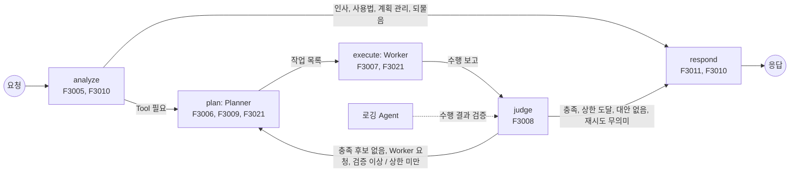
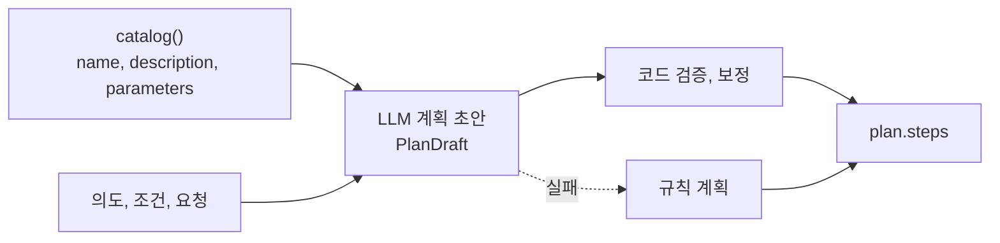
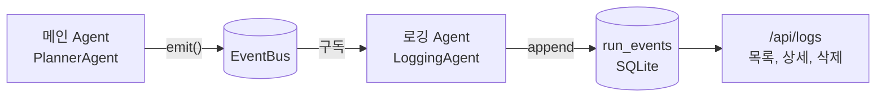
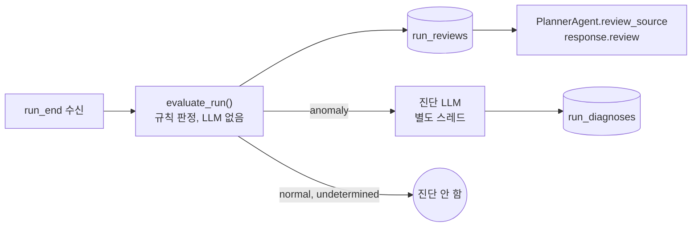
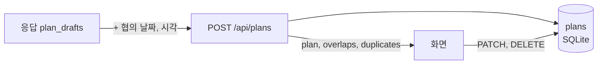
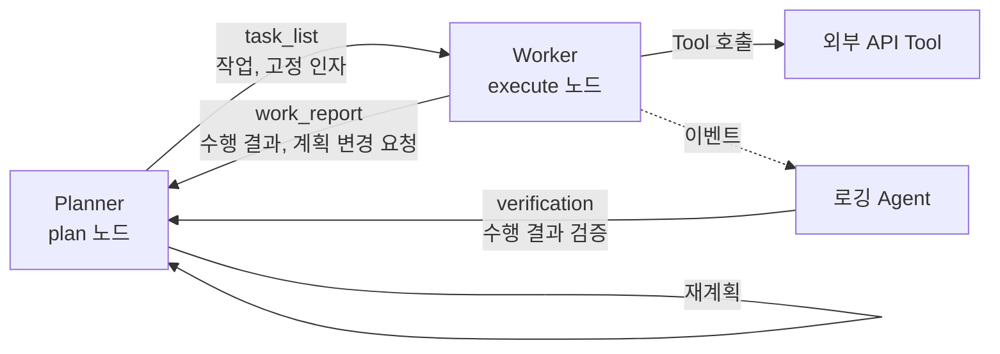
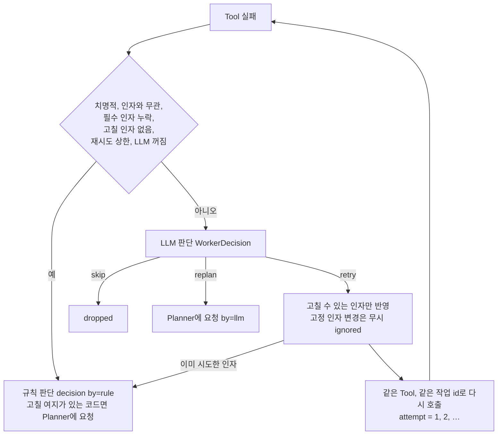

# Agent 설계 문서

- 작성일: 2026-11-18
- 구현 위치: [backend/app/agent/](../backend/app/agent/)
- 확인 결과: [verification_agent.md](verification/verification_agent.md), [verification_logging.md](verification/verification_logging.md), [verification_review.md](verification/verification_review.md), [verification_worker.md](verification/verification_worker.md)
- Tool: [tool_spec.md](tool_spec.md)

메인 Agent 실행 흐름, 로깅 Agent, 계획 관리 `F3005` ~ `F3016`, `F3020`, `F3021`

## 1. 한눈에 보기



| 파일 | 역할 | 요구사항 |
|---|---|---|
| [graph.py](../backend/app/agent/graph.py) | LangGraph 노드, 분기, 체크포인터, `PlannerAgent.run(session_id, message)` | 전체 |
| [state.py](../backend/app/agent/state.py) | 그래프 상태, 조건 모델(Pydantic), 조건 병합 | `F3005`, `F3010` |
| [analyzer.py](../backend/app/agent/analyzer.py) | LLM 의도 분류, 조건 추출, 비어 있는 조건 검사 | `F3005` |
| [planner.py](../backend/app/agent/planner.py) | LLM 계획 초안(Tool 명세로 선택), 초안 검증, 보정, 재계획 방법 선택 | `F3006`, `F3009` |
| [executor.py](../backend/app/agent/executor.py) | Tool 한 번 호출, 값 전달, 캐시 (`prepare`, `invoke`, `run_pending`) | `F3007` |
| [worker.py](../backend/app/agent/worker.py) | Worker: 작업 목록 수행, 실패 시 LLM 재시도 판단, 수행 보고 | `F3007`, `F3021` |
| [judge.py](../backend/app/agent/judge.py) | 제약 계산, 비교, 역산 기준 | `F3008` |
| [responder.py](../backend/app/agent/responder.py) | 최종 응답 구조와 문장 | `F3011` |
| [config.py](../backend/app/agent/config.py) | 모델, 재계획 상한, 법정 기준, 면책 문구 | — |
| [logging_agent.py](../backend/app/agent/logging_agent.py) | 로깅 서브 Agent: 이벤트 구독, 실행 로그 저장, 수행 결과 검증, 판정, 진단 위임 | `F3013`, `F3020`, `F3021` |
| [reviewer.py](../backend/app/agent/reviewer.py) | 수행 결과 검증, 이상 징후 판정 규칙, LLM 진단 | `F3020`, `F3021` |
| [events/bus.py](../backend/app/events/bus.py) | `EventBus` 발행, 구독, `Emitter` | `F3012` |
| [storage/log_store.py](../backend/app/storage/log_store.py) | 실행 로그 저장소 (SQLite) | `F3013`, `F3014` |
| [api/logs.py](../backend/app/api/logs.py) | 실행 로그 목록, 상세, 삭제 API | `F3014` |
| [storage/plan_store.py](../backend/app/storage/plan_store.py) | 조정 협의 계획 저장소 (SQLite), 겹침, 중복 확인 | `F3015`, `F3016` |
| [api/plans.py](../backend/app/api/plans.py) | 계획 저장, 목록, 상세, 수정, 삭제 API | `F3015`, `F3016` |

## 2. 단계별 입출력

| 노드 | 입력 (상태) | 출력 (상태) | LLM |
|---|---|---|---|
| `analyze` | `user_message`, 직전 `conditions`, `history` | `intent`, `intent_reason`, 병합한 `conditions`, `changed`, `missing` | ✔ 구조화 출력 |
| `plan` (Planner) | `intent`, `conditions`, `user_message` (재계획이면 `replan`, `judgments`, `step_results`) | `plan` {source, draft, corrections, steps, rounds, skipped}, `replan_count`, 작업 목록 메시지 | ✔ 첫 계획만 |
| `execute` (Worker) | `plan`, `step_results`, `cache`, `calls` | 새 `step_results`, `cache`, `calls`, Tool 이름별 `results`, `worker_requests`, 수행 보고 메시지 | 고칠 여지가 있는 실패만 (16.3) |
| `judge` | `conditions`, `plan`, `step_results`, 로깅 Agent 검증, `worker_requests` | `judgments`, `replan` 또는 `stop_reason`, `planner_notes` | ✘ |
| `respond` | 위 전부 | `response`, 갱신한 `history`. Tool 원본(`step_results`, `cache`, `results`)은 비운다 | 그 밖의 대화만 |

### 2.1 상태

| 범위 | 필드 |
|---|---|
| 세션 동안 유지 (체크포인터, `thread_id = session_id`) | `conditions`, `history` |
| 요청마다 `analyze`가 초기화 | `intent`, `changed`, `missing`, `plan`, `step_results`, `results`, `calls`, `cache`, `judgments`, `replan_count`, `replan`, `stop_reason`, `worker_requests`, `handled_requests`, `verified_steps`, `planner_notes`, `response` |

## 3. 요청 분석 `F3005`

### 3.1 의도

| 의도 | 예 | 다음 노드 |
|---|---|---|
| `plan` 조정 계획 수립 | "이번 분기에 요청할 수 있어? 얼마야?" | plan |
| `fact` 사실 조회 | "열연강판 지수가 올해 얼마나 올랐어?" | plan |
| `eligibility` 대상 여부 판정 | "알루미늄이 원가의 8%인데 연동 대상이야?" | plan |
| `manage` 계획 확정, 관리 | "아까 계획 저장해 줘" | respond: 계획 관리 화면 안내. 저장, 수정, 삭제는 계획 관리 API가 맡는다 (14절) |
| `chat` 그 밖의 대화 | "안녕하세요", "어떻게 써?" | respond |

### 3.2 조건

| 분류 | 필드 | 대표 요청에서 뽑은 값 |
|---|---|---|
| 기준 | `client`, `product`, `unit_price_won`, `items[{name, kind, share_pct}]`, `base_month`, `current_month`, `timing` | A사, 프레임, 120000, 열연강판(material, 35), 202512, null, 이번 분기 |
| 선호 | `index_name`, `region`, `city` | null, null, null |
| 제약 | `threshold_pct`, `cycle` | 5, 분기 |

- LLM은 이번 메시지에 나온 값만 채운다. 말하지 않은 값은 `null` 이다.
- `current_month`는 사용자가 달을 콕 집어 말했을 때만 채운다. 비어 있으면 Tool이 최신 집계월을 쓰고 `note`로 밝힌다.
- 상대 날짜는 오늘 날짜로 환산한다 ("작년 12월" → 202512, "올해 얼마나" → 작년 12월 대비).

### 3.3 되묻기 (Tool 호출 전)

| 의도 | 비어 있으면 되묻는 조건 |
|---|---|
| `plan` | 원재료, 각 비중, 기준 시점, 약정 비율 |
| `eligibility` | 원재료, 각 비중 |
| `fact` | 원재료, 기준 시점 |

`unit_price_won`은 없어도 계산한다. 금액 대신 "단가의 x%" 로 답한다.

## 4. 작업 계획 수립 `F3006`

Tool의 설명을 보고 상황에 따라 Tool을 선택하여 호출해야 하므로, 첫 계획은 LLM이 고른다.



| 단계 | 하는 일 |
|---|---|
| ① LLM 초안 | `catalog()`를 프롬프트로 받아 `PlanDraft{steps[{tool, item, keyword, purpose}], reason}`를 구조화 출력으로 돌려준다 |
| ② 빼기 | 등록되지 않은 Tool, 이 의도에 필요 없는 Tool(대상 여부 판정의 지수 조회, 사실 조회의 조문 검색), 조건에 없는 항목, 비중 10% 미만 항목의 단계 |
| ③ 더하기 | 상세 조회 앞에 빠진 후보 조회, 변동률 계산에 필요한데 빠진 상세 조회, 전기요금 조회, 법정 비중 기준(제2조)의 근거 조문 검색 |
| ④ 고정 인자 | `base_month`, `current_month`, `region`, `city`, `include_trend`는 조건으로 채우고, `item_code`는 `args_from`으로 앞 단계와 잇는다. 약정서 지표 이름(`index_name`)을 말했으면 그 이름으로 후보를 찾는다 |
| ⑤ 기록 | `plan.source` = `llm` / `rule`, `plan.draft`, `draft_reason`(LLM이 고른 그대로), `plan.corrections`(뺀 것, 더한 것) |
| 실패 시 | LLM 오류, 형식 오류면 같은 규칙으로 계획하고 `source = rule`로 남긴다 `NF3003` |

검증을 마친 계획이 담는 Tool:

| 의도 | 원재료 (`material`) | 에너지경비 (`energy`) | 근거 조문 |
|---|---|---|---|
| `plan` | `search_material_item` → `get_material_price_index(include_trend)` | `get_industrial_power_price` | LLM이 고른 검색 + `"주요 원재료"` / `"에너지경비"` |
| `fact` | `search_material_item` → `get_material_price_index` | `get_industrial_power_price` | — |
| `eligibility` | — | — | 위와 같음 |
| `chat`, `manage` | 계획 단계를 건너뛴다 | | |

대표 요청에서 LLM이 고른 초안과 보정:

```json
{"source": "llm",
 "draft": [{"tool": "search_material_item", "item": "열연강판", "keyword": "열연강판"},
           {"tool": "get_material_price_index", "item": "열연강판", "keyword": null},
           {"tool": "search_law_article", "item": null, "keyword": "납품대금 연동"}],
 "corrections": ["법정 비중 기준의 근거 조문을 얻도록 '주요 원재료' 조문 검색을 더했습니다."]}
```

단계 형식:

```json
{"id": "s2", "tool": "get_material_price_index",
 "args": {"base_month": "202512", "include_trend": true},
 "args_from": {"item_code": "s1.candidates[0].item_code"},
 "role": "index", "item": 0, "candidate": 0, "round": 0, "purpose": "열연강판 기준 시점 대비 변동률"}
```

`plan.rounds`에 첫 계획과 재계획마다 {round, strategy, reason, steps, reused} 를 쌓는다.

## 5. Tool 호출 및 결과 통합 `F3007`

| 규칙 | 구현 |
|---|---|
| 앞 Tool 결과 → 다음 Tool 입력 | `args_from`의 `s1.candidates[0].item_code`를 `step_results`에서 찾아 넣는다 |
| 결과 보관 | 단계 id 별 `step_results`, Tool 이름별 `results` |
| 실패 | 사유(`code`, `message`)를 기록하고 다음 단계로 진행한다 |
| 앞 단계 실패로 입력이 없음 | 호출하지 않고 `SKIPPED`로 기록한다 |
| 같은 Tool, 같은 인자 | `cache`에서 다시 쓰고 `calls[].cached = true`로 남긴다 |
| 호출 기록 | `calls[]` = {step, tool, args, ok, code, cached, elapsed_ms} |

## 6. 제약 적합성 판단 `F3008`

| 값 | 계산 | 출처 |
|---|---|---|
| 변동률 | (현재 지수 ÷ 기준 지수 − 1) × 100 | Tool `change_rate_pct` |
| 법정 비중 기준 | 비중 ≥ 10% | 상생협력법 제2조 12, 12의2 |
| 약정 조정 요건 | 변동률 ≥ 약정 비율 | 사용자 입력 |
| 조정 요청 금액 | 단가 × 비중 ÷ 100 × 변동률 ÷ 100 (원 단위 반올림) | 계산 |
| 요건 충족 지수 (역산) | 기준 지수 × (1 + 약정 비율 ÷ 100) | 계산 |
| 도달 예상 시점 (재조회 계획) | (요건 지수 − 현재 지수) ÷ 최근 6개월 평균 상승폭, 올림 | 계산, 추정 |

판단 결과 `status`:

| status | 조건 |
|---|---|
| `satisfied` | 비중 ≥ 10% 이고 후보 중 하나라도 변동률 ≥ 약정 비율 |
| `unsatisfied` | 비중 미달 또는 모든 후보의 변동률 미달 |
| `undetermined` | 지수, 요금을 확보하지 못함 (`NO_INDEX_VALUE` 등). 값을 채우지 않고 판단하지 않는다 |
| `info` | 사실 조회처럼 비교할 제약이 없음 |

외부 API로 확인할 수 없는 값은 지어내지 않고 기준으로 제시한다.

| 확인할 수 없는 값 | 제시하는 기준 |
|---|---|
| 직전 조정 시점 | 오늘 − 조정 주기. 예: "직전 조정이 2026년 8월 이전이었다면 지금 요청할 수 있습니다" |
| 약정서의 기준 지표 | "약정서의 기준 지표가 ECOS 열연강판(307125AA)일 때만 이 변동률이 그대로 적용됩니다" |
| 다음 지수 발표일 | 날짜를 정하지 않고 "2026년 10월 지수가 집계된 뒤 다시 조회" |
| 사업장 실제 전기요금 | 지역 산업용 평균판매단가라는 산정 기준과 계절 요금 차이 안내 |

## 7. 재계획 `F3009`

| 구분 | 조건 |
|---|---|
| 재계획함 | 의도가 `plan`, `eligibility` 이고 `satisfied` 항목이 하나도 없음 / 로깅 Agent가 고정 인자 변경을 검증 (`verify_fix`) / Worker가 해결하지 못한 실패를 Planner가 작업으로 바꿀 수 있음 (`worker_request`) |
| 재계획 안 함 | 하나라도 충족 / `INVALID_KEY`, `UPSTREAM_ERROR` 발생 (다시 불러도 결과가 같음) / 상한 도달 / 남은 방법 없음 |
| 상한 | `MAX_REPLAN` (기본 3, 1 ~ 10). 도달하면 사유와 함께 조건 조정을 되묻는다 |

방법은 아래 순서로 처음 해당하는 하나를 고른다. 0-1, 0-2는 `F3021`에서 더했으며, 충족 항목이 있어도 고른다.

| 순서 | 방법 | 해당 조건 | 새 Tool 호출 |
|---|---|---|---|
| 0-1 | `verify_fix` 검증 결과 반영 | 로깅 Agent가 이번 라운드에서 고정 인자 변경을 찾음 | 지적된 작업과 그 결과를 입력으로 쓴 작업을 버리고(`discarded`), Planner가 정한 인자 그대로 다시 수행 (`no_retry`) |
| 0-2 | `worker_request` Worker 요청 반영 | Worker가 올린 요청 중 Planner가 작업으로 바꿀 수 있는 것이 있음 (16.4), 치명적 실패 없음 | 사용자가 말한 원재료 이름으로 품목 검색 → 지수 조회 / 아직 쓰지 않은 법정 기준 검색어로 조문 검색 |
| 1 | `next_candidate` 다른 후보 지표 | 첫 후보 조회가 실패했거나, 원재료 이름이 ECOS 품목명과 정확히 같지 않음 (예: 철판 → 열연강판, 중후판) | 다음 후보의 `get_material_price_index` |
| 2 | `recheck` 재조회 계획 | 변동률 미달이고 추세가 있음 | 없음. 이미 받은 `trend`로 도달 시점 추정 |
| 3 | `alt_path` 다른 협의 경로 | 미충족 항목이 있음 | `search_law_article("상생협력법", "납품대금 조정")` → 제22조의2 |

재사용: 끝난 단계는 계획에 그대로 두고 결과가 없는 단계만 호출한다. 같은 인자는 캐시에서 다시 쓴다. 각 round의 `reused`에 재사용한 단계를 남긴다.

## 8. 대화 맥락 `F3010`

| 보관 | 보관하지 않음 |
|---|---|
| 누적 조건 `conditions` | Tool 원본 응답 (`step_results`, `cache`, `results`) |
| 직전 5회 대화 요약 `history` = {user, intent, summary} | 요청별 계획 실행 중간값 (`judgments`) |

- 저장소: LangGraph `MemorySaver`, 세션 id를 `thread_id`로 쓴다.
- 갱신: LLM은 바뀐 값만 `update`로 돌려주고, 코드가 직전 조건에 덮어쓴다 (`merge_conditions`). `changed`에 바뀐 필드를 남긴다.
- 원재료 목록: `items_mode` = keep / replace / add. 하나를 하나로 바꾸며 비중을 말하지 않으면 직전 비중을 이어 쓴다 ("같은 조건에서 원재료만 알루미늄으로").

## 9. 최종 응답 `F3011`

숫자와 조문은 Tool 결과와 판단 결과에서만 가져와 규칙으로 조립한다.

| 필드 | 내용 |
|---|---|
| `kind` | `result` / `clarify` / `chat` / `notice` |
| `recommendations` | 요건을 충족한 항목, 지표, 변동률, 요청 금액 |
| `criteria` | 항목별 검사(값, 기준, 충족 여부), 역산 기준, 재조회 추정 |
| `unverified` | API로 확인할 수 없어 사용자가 확인할 사항 |
| `excluded` | 제외한 항목, 후보와 사유 |
| `aux` | 근거 조문 (법령, 조문 번호, 제목, 발췌, 링크) |
| `evidence` | 근거 Tool 결과 (단계, Tool, 인자, 요약, 재사용 여부) |
| `plan`, `replans`, `stop_reason` | 계획과 재계획 이력, 멈춘 사유 |
| `plan_drafts` | 요건을 충족한 항목마다 저장할 계획의 핵심 값 (14절). 협의 날짜, 시각은 비워 둔다 |
| `session_id`, `run_id` | 응답을 만든 세션과 요청. `plan_drafts`에도 붙인다 |
| `disclaimer` | 면책 안내. 결과, 대화 응답에 항상 붙인다 |
| `text` | 위 구조로 만든 Markdown |

`INVALID_KEY`, `UPSTREAM_ERROR`는 Tool 메시지 대신 일반 안내 문구로 바꿔 보여 준다. `NF3002`

## 10. LLM 호출 조건

| 호출함 | 호출하지 않음 |
|---|---|
| `analyze`: 의도 분류, 조건 추출 (모든 요청 1회) | 되묻기, 인사, 계획 관리 요청의 계획 |
| `plan`: Tool이 필요한 요청의 첫 계획 초안 (요청당 1회) | 초안 검증, 보정, 재계획 방법 선택, Worker 요청 처리 (판단 결과로 고를 수 있어 규칙으로 한다) |
| Worker: 인자를 고치면 결과가 달라질 수 있는 실패에서 재시도, 건너뜀, 계획 변경 요청 판단 (16.3) | Worker의 정상 경로, 치명적 실패, 필수 인자 누락, 고칠 인자 없음, 재시도 상한 도달 |
| `respond`: `chat` 의도의 답변 | Tool 호출, 계산, 결과 응답 조립 |
| 로깅 Agent: 이상(`anomaly`)으로 판정한 실행의 원인 진단 (실행당 1회, 별도 스레드) | 로깅 Agent의 이벤트 수집, 저장, 수행 결과 검증, 이상 징후 판정, 정상과 판정 불가 실행 |

Tool이 필요한 요청은 LLM을 2회(분석, 계획)에 Worker 판단 횟수를 더해, 인사, 사용법은 2회(분석, 대화), 되묻기는 1회 호출한다.
분석 LLM이 실패하면 `notice` 응답을, 계획 LLM이 실패하면 규칙 계획을, 대화 LLM이 실패하면 고정 안내 문구를 쓴다. 예외를 밖으로 내지 않고 오류 원문도 싣지 않는다.

## 11. 설정

| 환경변수 | 기본값 | 뜻 |
|---|---|---|
| `OPENAI_API_KEY` | — | OpenAI API 키 |
| `LLM_MODEL` | `gpt-6-luna` | 분석, 계획, 대화 모델 |
| `LLM_REASONING_EFFORT` | 추론 모델(`gpt-5`, `gpt-6` 계열)이면 `none` | chat/completions에서 추론 모델이 함수 호출(구조화 출력)을 쓰려면 `none` 이어야 한다 |
| `MAX_REPLAN` | `3` | 재계획 상한 `NF3004` 그래프 `recursion_limit`도 이 값으로 정한다 |
| `PLANNER_DB_PATH` | `data/planner.db` | 실행 로그 저장소 (SQLite) |
| `WORKER_LLM` | `on` | Worker의 LLM 판단 사용 여부. `off` 면 고칠 여지가 있는 실패도 바로 Planner에 보고 `F3021` |
| `WORKER_MAX_RETRY` | `2` | Worker가 같은 Tool로 다시 부르는 횟수 상한 (0 ~ 5) |

## 12. 실행 이벤트와 로깅 Agent `F3012` ~ `F3014`



- 메인 Agent는 `EventBus`로 발행만 한다. 구독자를 알지 못하며, 구독자가 없거나 예외를 던져도 발행은 그대로 끝난다.
- 로깅 Agent는 받은 이벤트를 즉시 덧붙인다. LLM을 호출하지 않고, 요약하거나 고치지 않는다. 저장에 실패하면 `failures`만 늘리고 대화는 계속한다.
- 두 Agent는 [main.py](../backend/app/main.py) 의 `create_app()` 에서만 연결한다.

### 12.1 이벤트 형식

```json
{"session_id": "a429…", "run_id": "7f1c…", "seq": 3, "type": "decision", "node": null,
 "ts": "2026-11-19T10:12:03.512+09:00",
 "data": {"by": "llm", "kind": "intent", "choice": "plan", "reason": "납품 조건과 약정 요건을 제시하고 …"}}
```

| 필드 | 뜻 |
|---|---|
| `session_id` | 대화 세션. 실행 로그의 저장 단위 |
| `run_id` | 세션 안의 요청 1건 |
| `seq` | 요청 안의 발생 순서 (1부터) |
| `node` | 발생한 노드. 요청 단위 이벤트는 `null` |

| `type` | 발행 시점 | `data` |
|---|---|---|
| `run_start` | 요청 수신 | `message` |
| `node_start` | 노드 진입 | — |
| `node_end` | 노드 종료 | `ok`, `elapsed_ms`, 노드별 요약 (아래) |
| `tool_request` | Tool 호출 직전 | `step`, `round`, `tool`, `args`, `attempt`(Worker 재시도일 때 1부터) |
| `tool_response` | Tool 응답 직후 | `step`, `round`, `tool`, `ok`, `code`, `elapsed_ms`, `result`(원본 응답) |
| `tool_reused` | 캐시 재사용 (호출하지 않음) | `step`, `round`, `tool`, `args`, `ok`, `code` |
| `tool_skipped` | 앞 단계 실패로 건너뜀 | `step`, `round`, `tool`, `args`, `reason` |
| `decision` | 실행 흐름을 바꾸는 판단 | `by`(llm / rule), `kind`, `choice`, `reason` (Worker 판단은 `step`, `tool`, `code`, `args`, `ignored` 추가) |
| `agent_message` | Planner, Worker, 로깅 Agent 사이의 메시지 `F3021` | `sender`, `receiver`, `kind`(task_list / work_report / verification), `body` |
| `run_end` | 응답 완료 | `ok`, `kind`, `intent`, `replan_count`, `stop_reason`, `elapsed_ms` |

| 노드 | `node_end` 요약 |
|---|---|
| `analyze` | `intent`, `intent_reason`, `changed`, `missing`, `error` |
| `plan` | `round`, `strategy`, `source`, `steps`, `reused`, `corrections`, `skipped` |
| `execute` | `called`, `retried`, `reused`, `skipped`, `failed` |
| `judge` | `judgments[{item, status}]`, `replan`, `stop_reason` |
| `respond` | `kind` |

| `decision.kind` | `by` | 발행 노드 | 바뀌는 흐름 |
|---|---|---|---|
| `intent` | llm (분석 실패 시 rule) | analyze | 계획 단계로 갈지, 바로 응답할지 |
| `clarify` | rule | analyze | Tool 호출 전에 되묻기 |
| `plan` | llm (LLM 실패 시 rule) | plan | 호출할 Tool과 순서 |
| `replan` | rule | judge | 재계획 방법 (`verify_fix`, `worker_request`, `next_candidate`, `recheck`, `alt_path`) |
| `worker` | llm / rule | execute | Worker의 실패 처리 (`retry`, `skip`, `replan`, `report`). rule은 LLM에 묻지 않은 사유 |
| `stop` | rule | judge | 재계획 중단 사유 |

### 12.2 실행 로그 저장소

`data/planner.db` (`PLANNER_DB_PATH`로 변경). 이벤트 1건이 행 1개이며, `id` 순서가 실행 순서이다.

| 열 | 형식 |
|---|---|
| `id` | INTEGER, 자동 증가 |
| `session_id`, `run_id`, `type`, `node`, `ts` | TEXT |
| `seq` | INTEGER |
| `data` | TEXT (JSON 원문) |

`BEFORE UPDATE` 트리거로 수정을 막는다. 저장소에도 수정 메서드가 없다.

### 12.3 실행 로그 API

| 메서드, 경로 | 응답 | 없는 세션 |
|---|---|---|
| `GET /api/logs` | `{sessions: [{session_id, started_at, ended_at, runs, events, tool_calls, replans, first_message}]}` 최근 세션부터 | — |
| `GET /api/logs/{session_id}` | `{session_id, events: [{id, session_id, run_id, seq, type, node, ts, data}]}` 실행 순서 | 404 |
| `DELETE /api/logs/{session_id}` | `{session_id, deleted}` | 404 |

수정 API(`PUT`, `PATCH`)는 두지 않는다. `F3020` 이후 상세 응답에 `reviews`, 목록 응답에 `anomalies`가 더해졌다 (13.4).

## 13. 이상 징후 판단 `F3020`



- 로깅 Agent는 `run_end`를 받으면 저장소에서 그 요청의 이벤트를 다시 읽어 판정한다. 판정 근거는 저장된 실행 로그뿐이다.
- 진단은 판정과 다른 테이블에 저장하며 `warnings`를 바꾸지 않는다. 진단이 실패하면 `status = failed`만 남기고 오류 원문은 남기지 않는다. `NF3002`

### 13.1 판정 규칙

먼저 로그가 온전한지 본다. 첫 이벤트가 `run_start`, 마지막이 `run_end` 이고 `seq`가 1부터 빠짐없이 이어져야 한다. 아니면 모든 검사가 `undetermined` 이다.

| 검사 | `warn` 조건 | `undetermined` 조건 (근거 없음) |
|---|---|---|
| `repeated_call` 같은 입력 반복 호출 | `tool_request` 중 (Tool, 인자)가 같은 것이 2건 이상. `tool_reused`는 호출로 세지 않는다 | `execute` 진입과 종료 수가 다름 / `node_end(execute).called` 합계 ≠ `tool_request` 수 |
| `excessive_replan` 재계획 과도 반복 | `decision(kind=replan)` 수 ≥ 상한(`run_end.replan_limit`) / 같은 방법을 연달아 사용 | 계획 단계는 있는데 `judge` 종료가 없음 / `run_end.replan_count` ≠ 재계획 판단 수 |
| `unplanned_call` 계획에 없던 호출 | `tool_request`의 (step, tool) 이 어느 `node_end(plan).steps`에도 없음 | Tool을 호출했는데 계획 종료 이벤트가 없거나 `steps`가 없음 |
| `fixed_arg_changed` 고정 인자 변경 `F3021` | `tool_request`의 고정 인자 값이 작업 목록(`task_list`)의 값과 다름. 앞 단계 결과로 채운 고정 인자는 그 작업의 첫 호출 값과 비교 | Tool을 호출했는데 작업 목록 메시지가 없음 |

| `verdict` | 조건 |
|---|---|
| `anomaly` 이상 | `warn`이 하나라도 있음 |
| `undetermined` 판정 불가 | `warn` 없음, `undetermined`가 하나라도 있음 |
| `normal` 이상 없음 | 모든 검사가 `ok` |

`warnings`는 `warn` 검사의 `items` 수 합계이다. 재계획 상한 도달은 설계대로 멈춘 경우에도 `warn` 이다. 공개 지표로 약정 조건을 충족하지 못했다는 신호이므로 원인 진단을 붙인다.

### 13.2 진단

| 항목 | 내용 |
|---|---|
| 입력 | `warn` 검사 목록, 실행 기록(`seq type node data`, Tool 원본 응답 제외, 이벤트당 300자) |
| 출력 (구조화) | `agent`: planner / worker / main / logging / tool, `stage`: analyze ~ respond, tool, logging, `text`: 원인과 고칠 곳 |
| 후처리 | `text`를 세 문장까지 자른다 (`limit_sentences`, 소수점은 나누지 않음) |
| 실행 | `ThreadPoolExecutor(max_workers=1)`. 응답을 기다리게 하지 않는다. `wait()`로 완료를 기다릴 수 있다 |

### 13.3 메인 Agent의 참조

`PlannerAgent(review_source=)`는 `(session_id, run_id) → 판정` 함수만 받는다. `run()`은 `run_end`를 발행한 뒤 이 함수로 판정을 읽어 응답의 `review`에 싣는다. 로깅 Agent는 `run_end`를 동기로 처리하므로 이 시점에 판정이 저장되어 있고, 진단은 아직 없을 수 있다. 로깅 Agent가 없으면 `review = null` 이다.

```json
{"run_id": "…", "session_id": "…", "verdict": "anomaly", "warnings": 1,
 "checks": [{"check": "excessive_replan", "label": "재계획 과도 반복", "status": "warn",
             "message": "재계획 3회로 상한 3회에 도달했습니다.",
             "items": [{"reason": "limit", "count": 3, "limit": 3, "seq": [19, 28, 35]}]}, …],
 "created_at": "…",
 "diagnosis": {"status": "ok", "agent": "main", "stage": "plan", "text": "…", "created_at": "…"}}
```

### 13.4 저장소, API

| 테이블 | 열 |
|---|---|
| `run_reviews` | `run_id`(PK), `session_id`, `verdict`, `warnings`, `checks`(JSON), `created_at` |
| `run_diagnoses` | `run_id`(PK), `session_id`, `status`(ok / failed), `agent`, `stage`, `text`, `created_at` |

두 테이블 모두 `BEFORE UPDATE` 트리거로 수정을 막고, 세션을 삭제하면 함께 지운다.

| API | 추가 필드 |
|---|---|
| `GET /api/logs` | `sessions[].anomalies` 이상으로 판정한 요청 수 |
| `GET /api/logs/{session_id}` | `reviews[]` 요청 순서대로 판정과 진단 |

## 14. 계획 관리 `F3015`, `F3016`

계획 저장은 사용자가 이미 정한 값(협의 날짜, 시각)을 다루므로 Tool로 두지 않고 API로 제공한다.
계산 값은 응답의 `plan_drafts`에서 그대로 옮기고, 협의 날짜와 시각은 API로 확인할 수 없으므로 사용자가 정한다.



### 14.1 저장 항목

| 분류 | 필드 |
|---|---|
| 대상 | `client`, `product`, `item`, `item_kind`, `share_pct`, `unit_price_won` |
| 계산 근거 | `index_code`, `index_name`, `base_month`, `base_value`, `current_month`, `current_value`, `change_rate_pct`, `threshold_pct`, `law_refs` |
| 요청 금액 | `increase_ratio_pct`, `increase_won`, `new_price_won` |
| 일정 | `meeting_date` (YYYY-MM-DD), `start_time`, `end_time` (HH:MM, 종료 > 시작) |
| 진행 | `status` = `ready` 준비 / `requested` 요청함 / `agreed` 합의 / `rejected` 거절, `memo` |
| 기록 | `session_id`, `run_id`, `created_at`, `updated_at` |

### 14.2 겹침, 중복 (저장을 막지 않는다)

| 결과 필드 | 조건 |
|---|---|
| `overlaps` | 다른 계획과 `meeting_date`가 같고 `start < 상대 end` 이며 `상대 start < end`. 끝나는 시각에 시작하면 겹치지 않는다 |
| `duplicates` | 다른 계획과 `client`, `product`, `item`이 같고 그 계획이 `ready`, `requested` 상태 |

저장(`POST`)과 수정(`PATCH`) 모두 `{plan, overlaps, duplicates}`를 돌려준다.

### 14.3 계획 관리 API

| 메서드, 경로 | 요청 | 응답 |
|---|---|---|
| `POST /api/plans` | `PlanCreate` (14.1 핵심 값 + `session_id`, `run_id`) | 201 `PlanSaved` |
| `GET /api/plans` | — | `PlanList` (협의 날짜, 시작 시각 순) |
| `GET /api/plans/{id}` | — | `Plan`, 없으면 404 |
| `PATCH /api/plans/{id}` | `PlanUpdate` (바꿀 값만) | `PlanSaved`, 없으면 404, 필수 값을 비우거나 종료 ≤ 시작이면 422 |
| `DELETE /api/plans/{id}` | — | `PlanDeleted`, 없으면 404 |

## 15. 요구사항 대응표

| 요구사항 | 세부 조건 | 구현 |
|---|---|---|
| `F3005` | 기준, 선호, 제약 조건 추출, 뽑지 못한 조건은 비워 둠 | `Analysis`, `ConditionUpdate`, `grouped()`, `find_missing()` |
| `F3006` | Tool과 호출 순서를 계획으로 구성, 보관, 불필요한 Tool 제외, Tool 없는 요청은 계획 생략 | `make_llm_selector()`(catalog로 선택), `build_plan()` 검증, 보정, `state.plan`, `corrections`, `skipped`, `needs_tools()` |
| `F3007` | 계획대로 호출, 보관, 앞 결과를 다음 입력으로, 실패 사유 기록 후 진행 | `run_pending()`, `args_from`, `SKIPPED`, `by_tool()` |
| `F3008` | 속성으로 값 계산, 제약과 비교, 확인할 수 없는 값은 역산 기준 | `judge()`, `back_calc`, `unverifiable()` |
| `F3009` | 미충족 시 대안 탐색 재계획, 확보한 결과 재사용, 상한 도달 시 사유와 응답 | `choose_strategy()`, `apply_replan()`, `cache`, `max_replan()` |
| `F3010` | 직전 요청, 응답 기억, 바뀐 조건만 갱신 | `MemorySaver`, `merge_conditions()`, `history` |
| `F3011` | 추천, 보조 정보, 판단 기준, 근거 Tool 결과, 제외 사유, 면책 안내 | `build_response()` |
| `F3012` | 단계 진입, 종료, Tool 요청, 응답, 소요 시간, LLM 판단과 이유 발행, 로깅 Agent에 의존하지 않음 | `EventBus`, `Emitter`, `_traced()`, `_decision()`, `run_pending(emit=)` |
| `F3013` | 구독, 세션 단위 저장, 조회 가능한 구조, LLM 미사용, 저장 실패에도 대화 유지 | `LoggingAgent`, `RunLogStore.append()` |
| `F3014` | 세션 목록, 실행 순서 상세, 삭제, 수정 불가 | `GET`, `DELETE /api/logs`, `run_events_read_only` 트리거 |
| `F3020` | 실행 로그로 반복 호출, 과도 재계획, 계획 외 호출, 고정 인자 변경 판정, 근거 없으면 판정 불가, 메인 Agent 참조, 이상 실행에만 LLM 진단, 판정과 분리 저장 | `evaluate_run()`, `LoggingAgent.review()`, `make_llm_diagnoser()`, `run_reviews`, `run_diagnoses`, `PlannerAgent.review_source` |
| `F3015` | 최종 계획 저장, 핵심 값과 생성 일시, 목록, 상세, 겹치는 계획은 저장하되 알림 | `plan_drafts()`, `PlanStore.create()`, `overlaps()`, `POST`, `GET /api/plans` |
| `F3016` | 핵심 값 수정, 삭제, 결과 반영 | `PlanStore.update()`, `delete()`, `PATCH`, `DELETE /api/plans/{id}` |
| `F3021` | Planner·Worker 분리, 작업 목록과 수행 결과의 형식, Agent 별 LLM 호출 조건, 고칠 여지가 있는 실패에서만 Worker LLM, 고정 인자 유지, 해결 못한 실패는 Planner 재계획, 로깅 Agent 검증 후 재구성 | `plan` 노드, `Worker`, `task_list`, `work_report`, `verification` 메시지, `adjustable_args()`, `request_actions()`, `verify_round()`, `suspect_steps()` |

## 16. Planner·Worker 구조 `F3021`

### 16.1 역할



| Agent | 맡는 일 | LLM을 부르는 조건 | 부르지 않는 조건 |
|---|---|---|---|
| Planner | 요청을 작업 목록으로 분해, 고정 인자 표시, 재계획 (Worker 요청, 검증 결과, 제약 판단 반영) | Tool이 필요한 요청의 첫 작업 목록 초안 (요청당 1회) | 초안 검증, 재계획 방법 선택, Worker 요청 처리 (판단 결과로 고를 수 있음) |
| Worker | 작업 목록대로 필수 외부 API 툴 호출, 앞 작업 결과 전달, 실패 처리 | 인자를 고치면 결과가 달라질 수 있는 실패(`BAD_ARGUMENT`, `NOT_FOUND`, `NO_DATA`)이고 고칠 인자가 남아 있을 때 | 정상 경로, 치명적 실패, 필수 인자 누락, 인자와 무관한 실패(`NO_INDEX_VALUE`, `SKIPPED`), 고칠 인자 없음, `no_retry` 작업, 재시도 상한 도달, `WORKER_LLM=off` |
| 로깅 Agent | 이벤트 저장, Worker 수행 직후 수행 결과 검증, 요청 종료 판정 | 요청 종료 판정이 이상(`anomaly`)인 실행의 원인 진단 | 수집, 저장, 수행 결과 검증, 판정 |

### 16.2 주고받는 형식

세 메시지 모두 `agent_message` 이벤트로 실행 로그에 남는다.

**작업 목록** (Planner → Worker, `kind = task_list`, 라운드마다 1건)

```json
{"round": 0, "strategy": "initial", "discarded": [],
 "tasks": [{"id": "s1", "tool": "search_material_item", "args": {"keyword": "폴리프로필렌"}, "fixed": [], "purpose": "…"},
           {"id": "s2", "tool": "get_material_price_index", "args": {"base_month": "202512", "include_trend": true},
            "args_from": {"item_code": "s1.candidates[0].item_code"},
            "fixed": ["base_month", "include_trend", "item_code"], "purpose": "…"}]}
```

| 고정 인자 (`fixed`) | 이유 |
|---|---|
| `base_month`, `current_month`, `region`, `city` | 사용자 조건 |
| `item_code` 등 `args_from`으로 채우는 인자 | Planner가 고른 후보 |
| `include_trend`, `law_name` | Planner가 정한 계산 방식, 법령 |
| `search_material_item.keyword` (사용자가 약정서 지표 이름을 말한 경우만) | 약정서 조건 |

Worker가 고칠 수 있는 인자는 Tool 입력 규격에서 고정 인자와 `args_from`을 뺀 나머지다 (`adjustable_args()`). 품목, 조문 검색의 `keyword`, `max_results`가 여기에 해당한다.

**수행 보고** (Worker → Planner, `kind = work_report`)

```json
{"round": 0,
 "tasks": [{"step": "s1", "tool": "search_material_item", "status": "ok", "attempts": 2, "code": null}],
 "requests": [{"step": "s1", "tool": "search_material_item", "code": "NO_DATA", "by": "rule",
               "reason": "Worker의 LLM 판단을 끈 상태입니다.", "tried": [{"keyword": "PP"}]}]}
```

`status` = `ok` / `failed` / `skipped`(앞 작업 실패) / `dropped`(Worker가 건너뜀).

**수행 결과 검증** (로깅 Agent → Planner, `kind = verification`)

```json
{"round": 0, "verdict": "anomaly", "warnings": 1,
 "checks": [{"check": "fixed_arg_changed", "status": "warn", "message": "고정 인자를 바꿔 호출했습니다: s1 keyword",
             "items": [{"step": "s1", "changed": {"keyword": {"planned": "폴리프로필렌", "called": "합성수지"}}, "seq": [14]}]}, …]}
```

### 16.3 Worker의 실패 처리



- 재시도는 같은 작업 id로 하므로 계획 외 호출이 아니며, 인자가 다르므로 같은 입력 반복 호출도 아니다.
- Worker LLM이 실패하면 규칙으로 Planner에 보고한다. `NF3003`

### 16.4 Planner의 반영

| 받은 것 | Planner의 처리 | 작업으로 바꿀 수 없을 때 |
|---|---|---|
| 품목 검색 실패 요청 | 아직 쓰지 않은 사용자의 원재료 이름으로 품목 검색 → 지수 조회를 더한다 (`worker_request`) | 약정서의 기준 지표 이름을 되묻는다 (`planner_notes`, 응답 "다시 알려 주실 사항") |
| 조문 검색 실패 요청 | 아직 쓰지 않은 법정 기준 검색어로 조문 검색을 더한다 | 그 검색어를 뺀다 |
| 그 밖의 실패 요청 (지역, 기준월 등 사용자 조건) | — | 조건 확인을 되묻는다 |
| 검증 이상 (`fixed_arg_changed`) | 지적된 작업과 그 결과를 쓴 작업을 버리고 같은 인자로 다시 수행한다 (`verify_fix`, `no_retry`) | 재계획 상한이면 그대로 응답한다 |

검증과 요청 반영도 재계획 1회로 세며 상한(`MAX_REPLAN`)을 따른다.

### 16.5 구조 변경 전후

| 항목 | 변경 전 | 변경 후 |
|---|---|---|
| 실행 흐름 | analyze → plan → execute → judge → respond | 같은 그래프. plan이 Planner, execute가 Worker가 되고 세 Agent 사이의 메시지가 더해짐 |
| 실패 처리 | 실패를 기록하고 다음 단계로 진행 | Worker가 고칠 여지가 있는 실패를 LLM으로 재시도, 해결 못한 실패는 Planner가 재계획 |
| 수행 결과 검증 | 요청이 끝난 뒤 판정만 `F3020` | Worker 수행 직후 검증, 이상이면 Planner가 재구성 |

재계획 횟수, 요청당 LLM 호출 수, 응답 시간 비교: [verification_worker.md](verification/verification_worker.md)
