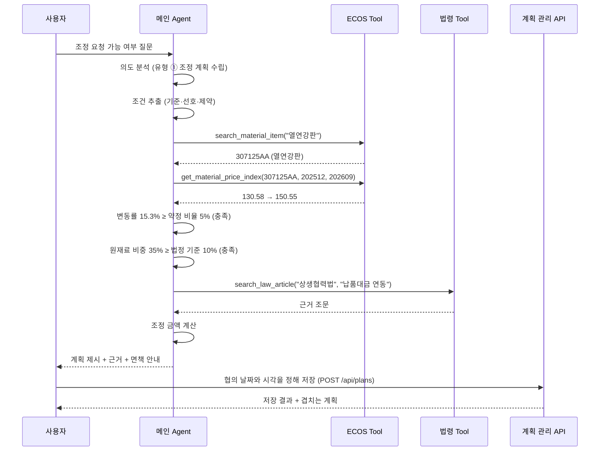
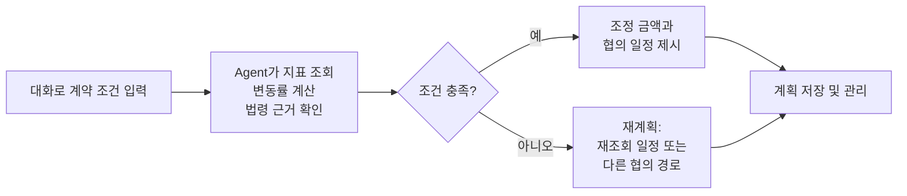

# 수탁기업 납품대금 조정 협의 플래너 제안서

- 작성일: 2026-11-18
- 개요: 원자재 가격이 오른 만큼 납품단가를 다시 정할 수 있는지 판단하고, 얼마를 언제 요청할지 계획해 주는 Agent 서비스

## 0. 먼저 알아 두면 좋은 용어

이 문서는 제조업 현장을 잘 모르는 개발자도 읽을 수 있도록 작성했습니다. 아래 용어만 알고 있으면 나머지 내용을 이해할 수 있습니다.

| 용어 | 뜻 | 개발자 관점의 비유 |
|---|---|---|
| 위탁기업 | 물건을 만들어 달라고 일을 맡기는 기업입니다. 흔히 "원청"이라고 부릅니다. | 외주를 맡기는 클라이언트 |
| 수탁기업 | 일을 맡아서 물건을 만들어 납품하는 기업입니다. 흔히 "하청"이라고 부릅니다. | 외주를 받는 개발사 |
| 납품대금(납품단가) | 수탁기업이 물건을 납품하고 받는 돈입니다. 보통 "개당 얼마"처럼 계약서에 정해 둡니다. | 계약 단가 |
| 주요 원재료 | 물건을 만드는 데 쓰는 원재료 중에서, 그 비용이 납품대금의 10% 이상을 차지하는 원재료입니다. | 원가에서 비중이 큰 핵심 리소스 |
| 납품대금 연동제 | 주요 원재료 가격이 미리 약속한 비율 이상 오르거나 내리면, 그 변동분만큼 납품대금을 조정하도록 한 제도입니다. 2023년 10월부터 시행되었습니다. | 클라우드 비용이 일정 비율 이상 오르면 계약 금액을 자동으로 조정하는 조항 |
| 연동 약정서 | 어떤 원재료를, 어떤 지표로, 몇 % 이상 변하면, 어떤 주기로 조정할지 적어 둔 서류입니다. | 단가 조정 조건을 적은 SLA 부속서 |
| 생산자물가지수 | 한국은행이 매달 발표하는 품목별 가격 지수입니다. 기준 연도(2020년)를 100으로 놓고 지금 가격 수준을 숫자로 나타냅니다. | 원재료별 가격 변동을 보여 주는 공식 시계열 데이터 |
| 변동률 | 기준 시점의 지수와 현재 지수를 비교해 몇 % 올랐는지 계산한 값입니다. | (현재값 ÷ 기준값 − 1) × 100 |

---

## 1. 도메인 정의

### 1.1 도메인 한 줄 요약

**대구 지역의 중소 제조 수탁기업(이하 "S사")이 원자재와 에너지 가격 상승분을 납품단가에 반영할 수 있도록, 연동 대상 여부를 판정하고 조정 요청 금액과 협의 일정을 계획하는 서비스입니다.**

### 1.2 Tool로 래핑할 외부 API

세 API는 각각 "원재료 가격", "법령 근거", "에너지 비용"이라는 서로 다른 정보를 제공합니다.

| # | API | 제공 정보 | 서비스에서 맡는 역할 |
|---|---|---|---|
| 1 | 한국은행 ECOS 생산자물가지수(기본분류, 통계표 코드 `404Y014`) | 품목별 월간 가격 지수. 열연강판, 철근및봉강, 형강, 철강관, 알루미늄1차제품, 금속주물, 베어링·기어 등 | 원재료 가격의 변동률을 계산합니다. |
| 2 | 국가법령정보 공동활용 Open API | 법령 본문과 조문 | 연동 요건과 조정 협의의 근거 조문을 조회해 판단의 근거로 제시합니다. |
| 3 | 한국전력 전력데이터개방포털 계약종별 전력사용량 | 계약종별 전력사용량, 고객호수, 전기요금, 평균판매단가 | 2026년에 연동 대상으로 추가된 에너지경비(전기료)의 변동을 판단합니다. |

### 1.3 외부 API의 출처와 이용 조건

| API | 출처 | 인증 방식 | 호출 한도 | 확인 상태 |
|---|---|---|---|---|
| ECOS 생산자물가지수 | 한국은행 경제통계시스템(ecos.bok.or.kr) | 무료 인증키 발급. 개발용 공개 샘플 키(`sample`)도 제공됩니다. | 샘플 키는 한 번에 최대 10건까지만 조회됩니다. 정식 키의 일일 한도는 공개 페이지에서 확인하지 못함 | **실제 호출 성공.** 월별 데이터가 2026년 9월분까지 들어와 있습니다. |
| 국가법령정보 공동활용 API | 법제처 국가법령정보센터(open.law.go.kr) | 사용자 식별자(OC) 등록과 호출 서버의 IP·도메인 등록이 필요합니다. | 공개 페이지에서 확인하지 못함 | **실제 호출 성공 (JSON).** 상생협력법 검색과 본문 조회에 성공했습니다. 처음에는 JSON 형식이 미신청 상태라 XML만 열려 있었고, 형식을 추가 신청한 뒤 JSON으로 받습니다. |
| 한전 계약종별 전력사용량 | 한국전력 전력데이터개방포털(bigdata.kepco.co.kr) | 회원가입 후 API 키 발급 | 공개 페이지에서 확인하지 못함 | **실제 호출 성공.** 대구 산업용 시군구별 데이터가 2026년 9월분까지 들어와 있습니다. 잘못된 키로 호출하면 `InvalidApiKeyException`을 돌려줍니다. |

> **참고:** AI 에이전트용 법령 API인 "법망"(api.beopmang.org)도 검토했습니다. 하지만 서버 장애로 서비스가 중단되었고 2027년 1분기에 재개될 예정이라서, 이번 프로젝트에서는 법제처 공식 API를 사용합니다.

### 1.4 Tool 결과를 제약 조건과 비교해야 답할 수 있는 요청

| # | 요청 | 비교해야 하는 것 |
|---|---|---|
| 1 | "A사에 납품하는 프레임이 개당 12만 원이고, 열연강판이 납품대금의 35%야. 약정서에는 5% 이상 변동하면 분기마다 조정한다고 돼 있어. 이번 분기에 조정을 요청할 수 있어? 얼마를 요청하면 돼?" | 지수 변동률과 약정 비율(5%)을 비교하고, 원재료 비중을 반영해 조정 금액을 계산합니다. |
| 2 | "B사 납품 건은 알루미늄이 원가의 8% 정도인데, 이것도 연동 대상이야?" | 원재료 비중(8%)과 법정 기준(10%)을 비교합니다. 대상이 아니면 다른 협의 경로를 찾습니다. |
| 3 | "C사 납품 브래킷은 열연강판이 원가의 30%고, 약정 비율은 10%야. 기준 시점은 올해 3월이야. 이번 달에 조정 요청할 수 있어?" | 지수 변동률과 약정 비율(10%)을 비교하고, 미달이면 요건 충족 지수를 역산해 다시 조회할 시점을 제시합니다. |
| 4 | "우리 공장은 전기료가 납품대금의 12% 정도 돼. 전기료가 올라서 단가 조정을 요청할 수 있을까?" | 에너지경비 비중(12%)과 법정 기준(10%), 전기요금 변동률과 약정 비율을 비교합니다. |

### 1.5 사용자가 저장·조회·수정·삭제할 결과물

**조정 협의 계획**을 저장합니다. 하나의 계획은 "어느 위탁기업과, 어떤 품목에 대해, 어떤 근거로, 얼마를, 언제 요청할지"를 담습니다. 핵심 값은 3.6절에서 자세히 설명합니다.

### 1.6 위험 도메인 여부와 면책 안내

이 도메인은 법률 해석과 금전 판단이 함께 걸려 있으므로 **판단이 위험한 도메인에 해당합니다.** 따라서 모든 계획 결과에 아래 문구를 함께 표시합니다.

> 이 결과는 공개된 가격 지표와 법령을 바탕으로 계산한 참고 자료이며, 법률 자문이 아닙니다. 실제 조정 협의는 체결한 약정서의 내용을 기준으로 하며, 필요하면 중소벤처기업부 납품대금 연동지원본부나 법률 전문가와 상담하시기 바랍니다.

---

## 2. 제안 배경 및 문제점 (AS-IS)

### 2.1 원자재 가격은 오르는데, 납품단가는 그대로입니다

대구의 소규모 제조업체들이 모인 산업단지에서는 원자재값과 운송비는 계속 오르는데 일감은 줄었다는 목소리가 나오고 있습니다. 2026년 5월 보도에서도 오른 원자재 가격이 납품단가에 반영되지 않는 문제가 지적되었습니다.

실제 지표도 이를 뒷받침합니다. 한국은행 ECOS에서 직접 조회한 생산자물가지수를 보면, 2025년 12월부터 2026년 9월까지 아홉 달 동안 금속 원재료 가격이 크게 올랐습니다.

| 품목 | 2025년 12월 | 2026년 9월 | 변동률 |
|---|---|---|---|
| 열연강판 | 130.58 | 150.55 | **+15.3%** |
| 철근및봉강 | 137.92 | 156.11 | **+13.2%** |
| 알루미늄1차제품 | 142.27 | 167.05 | **+17.4%** |

세 품목 모두 법이 허용하는 연동 기준의 최대치인 10%를 넘었습니다. 즉 연동 약정을 맺은 계약이라면, 조정을 요청할 수 있는 조건이 이미 갖춰졌을 가능성이 높습니다.

### 2.2 제도는 있지만, 현장에서는 쓰이지 않습니다

이런 상황을 위해 만들어진 제도가 **납품대금 연동제**입니다. 그런데 이 제도는 현장에서 거의 작동하지 않고 있습니다.

- **제도를 모릅니다.** 수탁기업 10곳 중 8곳이 이 제도를 제대로 알지 못한다는 조사 결과가 있습니다.
- **대상인지 판단하기 어렵습니다.** 연동 대상이 되려면 원재료 하나의 비용이 납품대금의 10% 이상이어야 합니다. 이 비율은 원재료마다 따로 계산해야 하고, 여러 원재료를 합쳐서 계산할 수 없습니다. 그래서 여러 부품을 섞어 만드는 중소기업은 기준을 충족하기 어렵고, 기준을 충족한다고 답한 수탁기업은 12.5%에 그쳤습니다.
- **계산을 직접 해야 합니다.** 약정서에 적힌 지표를 찾아보고, 기준 시점과 현재 시점의 값을 비교하고, 원재료 비중을 곱해 조정 금액을 계산하는 일은 모두 수탁기업이 직접 해야 합니다.
- **제도도 계속 바뀝니다.** 2026년에는 전기료와 가스비 같은 에너지경비까지 연동 대상이 확대되었습니다. 바뀐 규정을 따라가는 일도 소규모 기업에게는 부담입니다.
- **정부도 실효성 부족을 인정하고 있습니다.** 2026년 10월 국정감사에서 중소벤처기업부 장관은 이 제도가 아직 실효성이 부족하다며 전체적으로 다시 검토하겠다고 밝혔습니다.

### 2.3 지금 수탁기업이 하는 일

현재 S사와 같은 소규모 수탁기업이 조정을 요청하려면 다음 과정을 모두 손으로 처리해야 합니다.

이 과정에서 생기는 문제는 다음과 같습니다.

| 문제 | 결과 |
|---|---|
| 지표를 정기적으로 확인하지 않습니다. | 조정을 요청할 수 있는 시점을 놓칩니다. |
| 원재료 비중을 잘못 계산합니다. | 대상이 아닌데 요청하거나, 대상인데 요청하지 않습니다. |
| 거래처마다 약정 조건이 다릅니다. | 어떤 계약이 언제 조정 대상인지 한눈에 파악하기 어렵습니다. |
| 계산 근거를 남기지 않습니다. | 협의 자리에서 위탁기업을 설득할 자료가 부족합니다. |

---

## 3. 서비스 시나리오

### 3.1 요청 유형

사용자의 요청을 다섯 가지로 나눕니다. Agent는 먼저 요청이 어느 유형인지 판단한 뒤 처리 방법을 정합니다.

| 유형 | 예시 | 처리 방법 |
|---|---|---|
| ① 조정 계획 수립 | "이번 분기에 A사에 조정 요청할 수 있어? 얼마야?" | Tool을 여러 번 호출하고, 제약을 비교하고, 필요하면 재계획합니다. |
| ② 사실 조회 | "열연강판 지수가 올해 얼마나 올랐어?" | ECOS Tool 하나만 호출해서 답합니다. |
| ③ 대상 여부 판정 | "알루미늄이 원가의 8%인데 연동 대상이야?" | 법정 기준과 비교하고, 법령 Tool로 근거 조문을 함께 제시합니다. |
| ④ 계획 확정·관리 | "아까 그 계획 저장해 줘", "A사 협의 날짜를 다음 주로 바꿔 줘" | 계획 관리 API로 계획을 저장, 조회, 수정, 삭제합니다. 사용자가 정한 값을 다루므로 Tool로 두지 않습니다. |
| ⑤ 그 밖의 대화 | "연동제가 뭐야?" | Tool 없이 설명하거나, 필요하면 법령 Tool을 호출합니다. |

### 3.2 조건 분류

대표 요청 "A사 납품 프레임이 개당 12만 원이고, 열연강판이 35%야. 약정서에는 5% 이상 변동하면 분기마다 조정한다고 돼 있어. 이번 분기에 요청할 수 있어?"에서 다음 조건을 추출합니다.

| 분류 | 의미 | 예시에서 추출한 값 |
|---|---|---|
| **기준 조건** | 계산의 출발점이 되는 값입니다. 없으면 계산할 수 없습니다. | 위탁기업(A사), 품목(프레임), 납품단가(12만 원), 주요 원재료(열연강판), 조정 시점(이번 분기) |
| **선호 조건** | 있으면 반영하고, 없으면 기본값을 씁니다. | 기준 지표(지정하지 않으면 원재료명과 가장 가까운 ECOS 품목), 협의 희망 시기 |
| **제약 조건** | 반드시 지켜야 하는 조건입니다. 충족하지 못하면 재계획합니다. | 원재료 비중(35%)이 법정 기준인 10% 이상이어야 함, 변동률이 약정 비율(5%) 이상이어야 함, 조정 주기(분기) |

### 3.3 Tool 목록

> 외부 API Tool의 확정된 입출력과 실패 코드는 [Tool 정의서](tool_spec.md)를 따릅니다.

| Tool 이름 | 종류 | 입력 | 출력 |
|---|---|---|---|
| `search_material_item` | 외부 API (ECOS), `F3002` | 원재료 이름(예: "열연"), 기준월(선택) | 일치하는 품목 코드 후보 목록 |
| `get_material_price_index` | 외부 API (ECOS), `F3003` | 품목 코드, 기준월, 현재월(선택) | 기준월, 현재월 지수와 변동률 |
| `get_industrial_power_price` | 외부 API (한전), `F3003` 보충 | 기준월, 현재월(선택), 시도, 시군구(선택) | 산업용 평균판매단가와 변동률 |
| `search_law_article` | 외부 API (국가법령정보), `F3004` | 법령명, 검색어 | 관련 조문 번호, 제목, 발췌, 링크 |

### 3.4 시나리오 1: 조정 계획 수립 (대표 시나리오)

**요청:** "A사 납품 프레임이 개당 12만 원이고, 열연강판이 35%야. 약정서에는 5% 이상 변동하면 분기마다 조정한다고 돼 있어. 기준 시점은 작년 12월이야. 이번 분기에 요청할 수 있어?"

**계산 과정**

| 단계 | 계산 | 결과 |
|---|---|---|
| 변동률 | (150.55 ÷ 130.58 − 1) × 100 | 15.3% |
| 단가 중 원재료 금액 | 120,000원 × 35% | 42,000원 |
| 조정 요청 금액 | 42,000원 × 15.3% | 개당 약 6,426원 |
| 조정 후 단가 | 120,000원 + 6,426원 | 개당 약 126,426원 |

> 위 숫자는 ECOS에서 실제로 조회한 2025년 12월과 2026년 9월의 지수로 계산한 예시입니다. 실제 계약에서는 약정서에 적힌 기준 시점, 지표, 산식을 그대로 따라야 합니다.

### 3.5 시나리오 2: 재계획이 일어나는 요청

**요청:** "C사 건은 형강이 원가의 20%고, 약정 비율은 8%야. 기준 시점은 올해 3월이야. 이번 달에 조정 요청할 수 있어?"

1. Agent는 형강 지수를 조회해 2026년 3월과 최신 월(9월)의 변동률을 계산합니다.
2. 변동률이 약정 비율 8%에 못 미치면, **"지금 요청하는 계획"은 제약을 충족하지 못합니다.**
3. Agent는 계획을 다음과 같이 바꿉니다.
    - 지금 요청하는 계획을 버리고, **다음 지수 발표 시점에 다시 조회하는 계획**으로 전환합니다.
    - 최근 추세를 근거로, 지금 속도라면 몇 달 뒤에 8%에 도달할지 참고용으로 알려 줍니다.
    - 조정 대상이 될 수 있는 다른 원재료나 에너지경비가 있는지 사용자에게 확인합니다.

**다른 재계획 사례**

| 상황 | 원래 계획 | 바뀐 계획 |
|---|---|---|
| 약정서에 적힌 지표 이름이 ECOS 품목과 정확히 맞지 않습니다. | 지정된 지표로 계산 | 가장 가까운 품목 후보 2~3개를 보여 주고, 사용자가 고른 품목으로 다시 계산합니다. |
| 원재료 비중이 10%에 못 미쳐 연동 대상이 아닙니다. | 연동 조정 금액 계산 | 연동 계산을 멈추고, 연동 대상이 아닌 경우의 조정 협의 관련 조문을 법령 Tool로 찾아 다른 협의 경로를 안내합니다. |

### 3.6 시나리오 3: 조건이 모자라 되물어야 하는 요청

**요청:** "철판값이 많이 올랐는데, D사한테 단가 올려 달라고 해도 돼?"

이 요청에는 계산의 출발점이 없습니다. 납품단가, 원재료 비중, 약정 비율, 기준 시점을 모르면 변동률과 조정 금액을 계산할 수 없습니다. 그래서 Agent는 **Tool을 호출하기 전에** 다음과 같이 되묻습니다.

> D사와의 조정 여부를 판단하려면 몇 가지 정보가 필요합니다.
> 1. D사에 납품하는 품목의 단가는 얼마인가요?
> 2. 그 단가에서 철판 비용이 차지하는 비율은 대략 몇 %인가요?
> 3. 연동 약정서가 있다면, 몇 % 이상 변동할 때 조정하기로 되어 있나요? 기준 시점은 언제인가요?

### 3.7 저장할 결과물과 겹침 처리

**조정 협의 계획의 핵심 값**

| 필드 | 설명 | 예시 |
|---|---|---|
| 위탁기업 | 협의 상대 | A사 |
| 품목 | 납품하는 물건 | 프레임 |
| 현재 단가 | 조정 전 단가 | 120,000원 |
| 주요 원재료 / 비중 | 연동 근거가 되는 원재료와 그 비중 | 열연강판 / 35% |
| 기준 지표 | 사용한 ECOS 품목 코드와 이름 | 307125AA 열연강판 |
| 기준값 / 현재값 | 기준 시점과 현재 시점의 지수 | 130.58(2025.12) / 150.55(2026.09) |
| 변동률 / 약정 비율 | 계산한 변동률과 약정서의 조건 | 15.3% / 5% |
| 요청 금액 | 개당 조정 요청 금액 | 6,426원 |
| 협의 날짜 / 시각 | 위탁기업과 협의할 날짜와 시작, 종료 시각 | 2026-11-25 14:00 ~ 15:00 |
| 상태 | 진행 단계 | 준비 / 요청함 / 합의 / 거절 |
| 생성 일시 / 수정 일시 | 저장하고 고친 시각 | 2026-11-19T12:06:54+09:00 |
| 근거 조문 | 판단 근거로 쓴 법령 조문 | 상생협력법 제2조 등 |

**겹침 처리 규칙**

| 상황 | 처리 |
|---|---|
| 같은 위탁기업, 같은 품목, 같은 원재료로 진행 중(준비, 요청함)인 계획이 이미 있습니다. | 저장은 허용하되, 진행 중인 계획을 저장 결과와 함께 보여 줍니다. 필요 없는 계획은 수정하거나 삭제합니다. |
| 같은 날짜에 협의 시간이 겹치는 계획이 이미 있습니다. | 저장은 허용하되, 겹치는 계획을 저장 결과와 함께 보여 줍니다. 한쪽이 끝나는 시각에 다른 쪽이 시작하면 겹치지 않습니다. |

### 3.8 실행 과정 로그 (로깅 서브 Agent)

메인 Agent는 실행 단계마다 이벤트를 발행하고, 로깅 서브 Agent는 이 이벤트를 받아 저장만 합니다. 로깅 서브 Agent는 LLM을 사용하지 않습니다.

| 이벤트 | 기록 내용 예시 |
|---|---|
| `intent_analyzed` | 유형 ① 조정 계획 수립 |
| `conditions_extracted` | 기준·선호·제약 조건 목록 |
| `tool_called` / `tool_returned` | `get_material_price_index(307125AA, 202512, 202609)` → 10건 |
| `constraint_checked` | 변동률 15.3% ≥ 약정 비율 5%: 충족 |
| `replanned` | 변동률 미달 → 재조회 계획으로 전환 |
| `final_response` | 요청 금액 6,426원, 면책 안내 포함 |

이 로그가 있으면 결과가 이상할 때 "지표를 잘못 골랐는지", "API가 빈 값을 돌려줬는지", "비교 로직이 틀렸는지"를 단계별로 진단할 수 있습니다.

---

## 4. 기대 효과 (TO-BE)

### 4.1 바뀌는 업무 흐름

### 4.2 AS-IS와 TO-BE 비교

| 항목 | AS-IS (지금) | TO-BE (서비스 도입 후) |
|---|---|---|
| 연동 대상 판단 | 법령을 직접 찾아 읽고 판단합니다. | 원재료 비중을 입력하면 법정 기준과 비교해 바로 판정하고, 근거 조문을 함께 보여 줍니다. |
| 가격 지표 확인 | 한국은행 사이트에서 품목을 찾아 직접 조회합니다. | Agent가 원재료 이름으로 품목 코드를 찾고 지수를 조회합니다. |
| 조정 금액 계산 | 엑셀로 직접 계산하고, 실수가 생기기 쉽습니다. | 같은 산식으로 계산하고, 계산 과정을 표로 남깁니다. |
| 조건 미충족 시 대응 | 그냥 포기하거나, 언제 다시 확인할지 잊어버립니다. | 재조회 일정을 만들거나 다른 협의 경로를 안내합니다. |
| 여러 거래처 관리 | 거래처마다 약정 조건을 따로 기억해야 합니다. | 약정 조건과 협의 계획을 한곳에 저장하고, 일정 겹침을 경고합니다. |
| 협의 자리의 근거 자료 | 근거가 말로만 남습니다. | 지표 값, 변동률, 근거 조문이 담긴 계획을 그대로 보여 줄 수 있습니다. |
| 제도 변경 대응 | 바뀐 규정을 직접 찾아봐야 합니다. | 2026년에 추가된 에너지경비 연동처럼 바뀐 규정을 Tool로 확인해 반영합니다. |

### 4.3 누구에게 도움이 되는가

- **S사와 같은 소규모 수탁기업:** 별도의 담당자 없이도 조정을 요청할 수 있는 시점과 금액을 알 수 있습니다. 오른 원가를 혼자 떠안는 일을 줄일 수 있습니다.
- **위탁기업:** 수탁기업이 공식 지표와 근거 조문을 바탕으로 요청하기 때문에, 협의가 감정적인 줄다리기가 아니라 숫자를 확인하는 과정이 됩니다.
- **제도 운영 측면:** 제도를 몰라서 쓰지 못하는 수탁기업이 줄어들면, 연동제가 현장에서 작동하는 데 도움이 됩니다.

---

## 5. 한계와 확인할 사항

| 항목 | 내용 | 대응 |
|---|---|---|
| 적용 대상의 한계 | 원재료 하나의 비중이 10%를 넘지 않는 기업은 연동 대상이 아닐 수 있습니다. 이런 기업에게는 조정 금액 계산보다 대상 여부 판정과 대안 안내가 핵심 기능이 됩니다. | 시나리오 2의 재계획(다른 협의 경로 안내)으로 대응합니다. |
| 지표의 한계 | ECOS 지수는 품목별 평균 지수입니다. 약정서가 특정 거래처 시세 같은 다른 지표를 쓰면 계산이 실제와 다를 수 있습니다. | 약정서의 지표를 사용자에게 확인받고, 다르면 사용자가 직접 값을 입력할 수 있게 합니다. |
| API 등록 절차 | 법령 API와 한전 API는 등록 승인이 필요합니다. | 개발 첫 주에 등록을 신청하고, 승인 전에는 고정된 샘플 응답으로 개발합니다. |
| 호출 한도 | 세 API 모두 각 사이트의 안내 페이지에서 호출 한도를 찾지 못했습니다. | 한도를 가정하지 않고 캐시로 호출을 줄입니다. 한도를 넘었다는 응답을 받으면 재계획하지 않고 안내합니다. |

---

## 6. 참고 자료

**제도와 법령**
- [택스캔버스: 대·중소기업 상생협력 촉진에 관한 법률 제2조 (주요 원재료, 납품대금 연동 정의)](https://www.taxcanvas.kr/core/law/0101652026092922033/history/2026-09-29/articles/0022021)
- [법무법인 신김 뉴스레터: 하도급대금(납품대금) 연동제 개념과 주요 원재료 산정 기준](https://shinkim.com/kor/media/newsletter/2189)
- [로톡: 중소기업 필독, 납품대금 연동제 (원재료별 10% 산정, 실무 프로세스)](https://www.lawtalk.co.kr/posts/78056)
- [KDI 경제정보센터: 에너지경비 납품대금 연동 기업 실무 가이드 발간 (2026.6)](https://eiec.kdi.re.kr/policy/materialView.do?num=283722)
- [코리아리걸: 하도급대금 연동 조정 요구 (2026년 에너지 연동 시행일)](https://korea.legal/wiki/%ED%95%98%EB%8F%84%EA%B8%89%EB%8C%80%EA%B8%88-%EC%97%B0%EB%8F%99-%EC%A1%B0%EC%A0%95-%EC%9A%94%EA%B5%AC/)

**현장의 문제**
- [매일신문: 대구 제3산업단지 업체들의 일감 감소와 납품단가 미반영 문제 (2026.5)](https://www.imaeil.com/page/view/2026050921231169734)
- [헤럴드경제: 납품대금 연동제 3년, 기업 절반은 내용도 모른다 (2026.7)](https://www.heraldk.com/article/2026070519270395454)
- [다음뉴스: 수탁기업 81%가 납품대금 연동제를 잘 알지 못해](https://v.daum.net/v/20250928170646173)
- [뉴시스: 연동제 조건 부합 12.5%, 상생 사업 개선 필요 (2026.7)](https://www.newsis.com/view/NISX20260722_0003719279)
- [YTN: 중기부 장관, 납품대금 연동제 실효성 재검토 (2026.10)](https://www.ytn.co.kr/_ln/0102_202610071620252940)
- [헤럴드경제: 제2기 납품대금 연동지원본부 출범 (2026.4)](https://www.heraldk.com/article/2026040920300046919)
- [메트로서울: 원자재 가격 변동에 따른 납품단가 변화 분석 사례](https://www.metroseoul.co.kr/article/20250215500009)

**외부 API**
- [한국은행 경제통계시스템 ECOS Open API](https://ecos.bok.or.kr/api/)
- [법제처 국가법령정보 공동활용 Open API](https://open.law.go.kr/)
- [한국전력 전력데이터개방포털](https://bigdata.kepco.co.kr/)
- [위키독스: 산업고용 분야 OpenAPI 목록 (한국전력 계약종별 전력사용량 항목)](https://wikidocs.net/475223)
