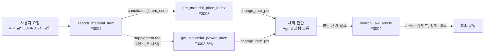

# Tool 정의서 `F3001` ~ `F3004`

- 작성일: 2026-11-18
- 대상 요구사항: `F3001` Tool 명세 정의 및 등록, `F3002` 후보 조회 Tool, `F3003` 상세정보 조회 Tool, `F3004` 보조 정보 검색 Tool
- 구현 위치: [backend/app/tools/](../backend/app/tools/)
- 확인 결과: [verification_tools.md](verification/verification_tools.md)

## 1. 한눈에 보기

| Tool 이름 | 요구사항 | 종류 | 외부 API | 하는 일 |
|---|---|---|---|---|
| `search_material_item` | `F3002` | 외부 API 툴 | 한국은행 ECOS 생산자물가지수(404Y014) 품목 목록 | 원재료 이름 → ECOS 품목 코드 후보 |
| `get_material_price_index` | `F3003` | 외부 API 툴 | 한국은행 ECOS 생산자물가지수(404Y014) 통계 조회 | 품목 코드 + 기준월 → 기준월, 현재월 지수와 변동률 |
| `get_industrial_power_price` | `F3003` `F3002` 보충 | 외부 API 툴 | 한국전력 전력데이터개방포털 계약종별 전력사용량 | 지역 산업용 전기 평균판매단가의 기준월 대비 변동률 |
| `search_law_article` | `F3004` | 외부 API 툴 | 법제처 국가법령정보 공동활용 (법령 검색, 본문) | 법령명 + 검색어 → 근거 조문 번호, 제목, 발췌, 링크 |

필수 Tool은 모두 **외부 API 툴**입니다. 계획 저장은 사용자가 정한 값을 다루므로 Tool이 아닌 API로 제공하며 `F3015`, 로컬 서버 API 툴이 필요한 심화 기능 `F3022`, `F3023`은 적용하지 않았습니다. 로컬 서버 API 툴을 더할 때는 같은 등록부에 `kind="local"`로 등록합니다.

### 1.1 Tool 사이의 값 전달



| 앞 Tool의 출력 | 다음 Tool의 입력 |
|---|---|
| `search_material_item` → `candidates[i].item_code` | `get_material_price_index.item_code` |
| `search_material_item` → `as_of` | `get_material_price_index.current_month` (선택) |
| `search_material_item` → `supplement.tool` | Agent가 `get_industrial_power_price`를 계획에 더한다 |
| 사용자 요청의 약정 기준 시점 | `get_material_price_index.base_month`, `get_industrial_power_price.base_month` |

변동률과 약정 비율, 법정 기준(10%)의 비교, 조정 금액 계산은 **모델 판단이 필요 없는 계산**이므로 Tool로 두지 않고 Agent 실행 흐름이 직접 수행합니다.

---

## 2. 공통 약속 `F3001`

### 2.1 응답 형식

모든 Tool은 성공과 실패를 같은 모양으로 돌려줍니다. Tool은 예외를 밖으로 던지지 않습니다.

```json
// 성공
{"ok": true,  "data": { ... }}
// 실패
{"ok": false, "error": {"code": "NO_DATA", "message": "사람이 읽을 사유"}}
```

- 응답 원본을 통째로 넘기지 않고 **판단에 쓸 값만** 뽑아 줍니다.
- 비어 있는 값을 `""` 나 `0`으로 채우지 않습니다. 판단에 필요한 값이 비면 실패(`NO_INDEX_VALUE`)로 돌려줍니다.
- 요청한 기준과 실제로 조회한 기준이 다르면 `estimated: true`와 `note`로 밝힙니다.
- `message`에는 API 키나 키가 든 주소를 넣지 않습니다. `NF3001` `NF3002` 사용자에게 주는 법령 링크도 인증값이 없는 공개 주소입니다.

### 2.2 실패 코드

| 코드 | 뜻 | 대표 상황 | Agent 처리 |
|---|---|---|---|
| `BAD_ARGUMENT` | 입력이 규격과 다르다 | 필수 인자 누락, `YYYYMM` 형식 틀림, 모르는 인자, 기준월 > 현재월, 지원하지 않는 지역 | 인자를 고쳐 다시 부르거나 사용자에게 되묻는다 |
| `INVALID_KEY` | 키가 없거나 틀렸다, 또는 키에 사용 권한이 없다 | `.env` 누락, 틀린 키, 법령 API 미신청, IP 미등록 | **재계획하지 않고** 설정 안내 |
| `NOT_FOUND` | 찾는 대상이 없다 | 없는 품목 코드, 없는 법령명, 없는 시군구, 등록되지 않은 Tool 이름 | 다른 후보로 바꾸거나 사용자에게 확인 |
| `NO_DATA` | 조회는 됐지만 결과가 비었다 | 일치하는 품목 없음, 검색어가 든 조문 없음, 최근 집계 없음 | 검색어를 바꾸거나 "찾지 못했다"고 안내 |
| `NO_INDEX_VALUE` | 판단에 필요한 값이 비어 있다 | 기준월 지수 없음(집계 시작 전), 한전 요금, 사용량 빈 값 | 그 항목은 **판단하지 않고 제외**하고 제외 사유를 밝힌다 |
| `UPSTREAM_ERROR` | 외부 API가 응답하지 않았다 | 시간 초과, 서버 오류, 해석할 수 없는 응답, Tool 내부 예외 | **재계획하지 않고** 잠시 후 다시 시도 안내 |

코드 묶음은 [base.py](../backend/app/tools/base.py) 의 `ErrorCode.FATAL`(같은 입력이면 결과가 같은 실패: `INVALID_KEY`, `UPSTREAM_ERROR`)과 `ErrorCode.RETRYABLE_WITH_NEW_ARGS`(인자를 고치면 달라질 수 있는 실패)로 미리 나눠 두었습니다. 재계획 `F3009`과 Worker 재시도 `F3021` 판단에서 그대로 씁니다.

### 2.3 실패를 만드는 단계

| 단계 | 위치 | 하는 일 |
|---|---|---|
| ① 입력 검사 | `Tool.validate()` | JSON Schema의 `required`, `type`, `enum`, `pattern`, `minimum/maximum`과 모르는 인자를 검사해 `BAD_ARGUMENT` |
| ② Tool 함수 | 각 Tool | 키 확인 → 외부 API 호출 → 응답 해석 → 값 추출. 외부 오류를 위 코드로 바꾼다 |
| ③ 안전망 | `Tool.run()` | 함수가 예외를 던지거나 약속과 다른 형식을 반환하면 `UPSTREAM_ERROR` (예외 원문은 포함하지 않는다) |
| ④ 이름 찾기 | `call_tool()` | 등록되지 않은 이름이면 `NOT_FOUND`, 인자가 객체가 아니면 `BAD_ARGUMENT` |

### 2.4 등록과 Agent에 넘기는 형식

```python
from app.tools import catalog, call_tool

catalog()            # Agent에 넘길 명세: [{"name", "description", "parameters"}]. 그 밖의 값은 넘기지 않는다
catalog("external")  # 외부 API 툴만
call_tool("search_material_item", {"keyword": "열연강판"})
```

`Tool` 정의([base.py](../backend/app/tools/base.py))의 필드는 다음과 같습니다. `kind`, `source`, `requirement`는 문서와 로그용이고 Agent에는 넘기지 않습니다.

| 필드 | 뜻 |
|---|---|
| `name` | Agent가 부르는 이름 (등록부의 키, 중복 금지) |
| `description` | **언제 호출하는지.** 모델은 이 설명만 보고 Tool을 고른다 |
| `parameters` | 입력 규격 (JSON Schema, `type: object`) |
| `func` | 실제로 일하는 함수 |
| `kind` | `external`(외부 API 툴) / `local`(로컬 서버 API 툴) |
| `source` | 외부 API 출처 |
| `requirement` | 대응 요구사항 번호 |

### 2.5 Tool을 더하는 방법

1. `backend/app/tools/<출처>.py`에 함수를 만든다. 성공은 `ok({...})`, 실패는 `fail(ErrorCode.X, "사유")`로 돌려준다.
2. 키는 `os.getenv("<키 이름>")`로 읽고, 없으면 `INVALID_KEY`를 돌려준다. `.env.example`에 키 이름을 더한다.
3. 외부 호출은 `base.http_get()`을 쓴다 (시간 초과 기본 15초, 연결 오류, 시간 초과, 5xx는 한 번 더 시도, 오류 원문 대신 `UpstreamError`).
4. [registry.py](../backend/app/tools/registry.py) 의 `_TOOLS`에 `Tool(name, description, parameters, func, kind, source, requirement)`을 더한다.
5. `backend/check_tools.py`에 정상, 실패 호출을 더하고, 이 문서에 Tool 절을 더한다.

---

## 3. Tool 별 명세

### 3.1 `search_material_item`: 후보 조회 `F3002`

| 항목 | 내용 |
|---|---|
| 설명 (모델이 읽는 문장) | 사용자가 말한 원재료 이름(예: 열연강판, 알루미늄, 철판)에 해당하는 한국은행 생산자물가지수 품목 코드를 모를 때 부른다. 변동률을 계산하기 전에 반드시 먼저 불러 item_code 후보를 얻는다. 후보가 여럿이면 이름이 정확히 같은 품목이 앞에 온다. 결과에 supplement가 있으면 그 Tool로 보충한다(전기료 등 에너지경비). |
| 외부 API | ECOS `StatisticItemList/{key}/json/kr/{start}/{end}/404Y014` |
| 키 | `ECOS_OPEN_API` |

**입력**

| 이름 | 형식 | 필수 | 기본값 | 설명 |
|---|---|---|---|---|
| `keyword` | string | ✔ | — | 원재료 이름. 공백, `ㆍ`는 무시하고 비교 |
| `as_of` | string `YYYYMM` | | 최신 집계월 | 후보가 이 달의 지수를 갖는지 볼 기준월 |
| `max_results` | integer 1~10 | | 5 | 돌려받을 후보 수 |

**출력 (`data`)** — 2026-11-18 실제 응답

```json
{
  "keyword": "열연강판",
  "requested_as_of": "202612",
  "as_of": "202609",
  "estimated": true,
  "note": "요청한 기준월(202612)은 아직 집계되지 않아 가장 최근 집계월(202609)로 대신 조회했습니다. 이 값은 추정입니다.",
  "total_matches": 1,
  "candidates": [
    {"item_code": "307125AA", "item_name": "열연강판", "parent_name": "열간압연강재",
     "weight": 3.6, "first_month": "196501", "latest_month": "202609", "has_as_of": true}
  ]
}
```

| 필드 | 뜻 |
|---|---|
| `candidates[].item_code` / `item_name` | 다음 Tool의 입력이 되는 식별자와 이름 |
| `weight` | 생산자물가지수 안의 가중치. 같은 이름이 아니면 큰 순서로 정렬 |
| `first_month` / `latest_month` | 이 품목의 지수가 있는 기간 |
| `has_as_of` | `as_of` 달의 지수가 있는지 |
| `requested_as_of` / `as_of` / `estimated` / `note` | 요청한 기준과 실제로 쓴 기준. 다르면 `estimated: true` |
| `supplement` (있을 때만) | 이 API로는 확보할 수 없는 후보를 보충할 Tool. 예: `{"tool": "get_industrial_power_price", "reason": "..."}` |

**규칙**

- **기본값:** `as_of`를 주지 않으면 일치한 품목들의 최신 집계월을 쓰고 `note`로 알린다.
- **추정 표시:** ECOS는 지난 달까지만 집계한다. 아직 집계되지 않은 달을 요청하면 최신 집계월로 대신 조회하고 `estimated: true`로 밝힌다.
- **별칭:** 현장 용어를 ECOS 품목명으로 넓혀 찾는다. 예: `철판 → 강판, 후판`, `구리 → 동`. 별칭표는 [ecos.py](../backend/app/tools/ecos.py) 의 `ALIASES`.
- **다른 API로 보충:** `전기, 전력, 에너지`가 들어간 검색어는 ECOS 품목(전기장비 등)과 별도로 `supplement`에 한전 Tool을 알려 준다. ECOS에 일치 품목이 하나도 없어도 보충할 Tool이 있으면 빈 후보와 함께 `ok`로 돌려준다.
- **캐시:** 품목 목록(월간 1,577행 중 `M` 주기)은 하루 동안 메모리와 `data/ecos/404Y014_items.json`에 저장해 다시 쓴다. `sample` 키는 한 번에 10행만 주므로 첫 호출에 약 4분이 걸린다. 정식 키는 1,000행씩 받는다.

**실패**

| 상황 | 코드 |
|---|---|
| `keyword` 빈 값, `as_of` 형식 틀림, `max_results` 범위 밖 | `BAD_ARGUMENT` |
| `ECOS_OPEN_API` 없음 / ECOS `INFO-100` | `INVALID_KEY` |
| 일치하는 품목 없음 (보충할 Tool도 없음) | `NO_DATA` |
| 시간 초과, ECOS `ERROR-xxx`, JSON 아님 | `UPSTREAM_ERROR` |

### 3.2 `get_material_price_index`: 상세정보 조회 `F3003`

| 항목 | 내용 |
|---|---|
| 설명 | 원재료 가격이 약정 기준 시점 대비 몇 % 변했는지 판단해야 할 때 부른다. search_material_item이 준 item_code와 약정서의 기준월을 넣으면 기준월, 현재월 지수와 변동률(change_rate_pct)을 준다. 현재월을 생략하면 최신 집계월을 쓴다. 재계획에 쓸 최근 추세가 필요하면 include_trend=true. |
| 외부 API | ECOS `StatisticSearch/{key}/json/kr/1/10/404Y014/M/{start}/{end}/{item_code}` |
| 키 | `ECOS_OPEN_API` |

**입력**

| 이름 | 형식 | 필수 | 기본값 | 설명 |
|---|---|---|---|---|
| `item_code` | string | ✔ | — | `search_material_item`의 `candidates[].item_code` |
| `base_month` | string `YYYYMM` | ✔ | — | 약정서의 기준 시점 |
| `current_month` | string `YYYYMM` | | 그 품목의 최신 집계월 | 비교할 달 |
| `include_trend` | boolean | | false | 현재월까지 최근 6개월 지수를 함께 받을지 (재계획 때 도달 시점 추정용) |

**출력 (`data`)** — 2026-11-18 실제 응답

```json
{
  "item_code": "307125AA", "item_name": "열연강판", "parent_name": "열간압연강재",
  "unit": "2020=100", "weight": 3.6,
  "base":    {"month": "202512", "value": 130.58},
  "current": {"month": "202609", "value": 150.55},
  "change_rate_pct": 15.29,
  "requested_current_month": null,
  "estimated": false,
  "note": "현재월을 지정하지 않아 최신 집계월(202609)을 기본값으로 사용했습니다.",
  "trend": [{"month": "202604", "value": 142.5}, "…", {"month": "202609", "value": 150.55}]
}
```

| 필드 | 뜻 |
|---|---|
| `change_rate_pct` | 제약 판단에 쓰는 값. `(current.value ÷ base.value − 1) × 100`, 소수 둘째 자리 |
| `item_name`, `parent_name`, `unit`, `weight` | 사용자에게 함께 보여 줄 속성 |
| `estimated`, `note` | 현재월을 최신 집계월로 대신했는지 |
| `trend` | `include_trend=true` 일 때만 |

**규칙**

- **판단하지 않은 채 두기:** 기준월이나 현재월 지수가 비어 있으면 값을 임의로 채우지 않고 `NO_INDEX_VALUE`를 반환한다. Agent는 그 원재료를 판단에서 빼고 제외 사유를 밝힌다.
- 기준월, 현재월 두 달만 각각 조회하므로 기간이 길어도 `sample` 키의 10행 한도에 걸리지 않는다.

**실패**

| 상황 | 코드 |
|---|---|
| 필수 인자 누락, 형식 틀림, 기준월이 현재월보다 늦음 | `BAD_ARGUMENT` |
| 키 없음 / 틀림 | `INVALID_KEY` |
| 품목 목록에 없는 코드 | `NOT_FOUND` |
| 기준월, 현재월 지수가 비어 있음 (예: 집계 시작 전 달), 기준월 지수 0 | `NO_INDEX_VALUE` |
| 시간 초과, 해석할 수 없는 응답 | `UPSTREAM_ERROR` |

### 3.3 `get_industrial_power_price`: 에너지경비 상세 조회 `F3003`, `F3002` 보충

2026년부터 연동 대상에 **주요 에너지경비**(상생협력법 제2조 12의2)가 더해졌습니다. ECOS 원재료 품목으로는 지역 전기요금을 확보할 수 없어, 다른 출처(한전)의 API를 래핑한 Tool로 보충합니다.

| 항목 | 내용 |
|---|---|
| 설명 | 전기료(주요 에너지경비)가 올라 납품대금 조정이 가능한지 판단해야 할 때 부른다. 지역 산업용 전기 평균판매단가(원/kWh)를 기준월과 현재월로 비교한 변동률을 준다. 원재료 지수가 아니라 에너지경비가 대상일 때만 쓴다. |
| 외부 API | 한전 `openapi/v1/powerUsage/contractType.do?year&month&metroCd&cntrCd=300&returnType=json` |
| 키 | `KEP_CO_API` |

**입력**

| 이름 | 형식 | 필수 | 기본값 | 설명 |
|---|---|---|---|---|
| `base_month` | string `YYYYMM` | ✔ | — | 약정서의 기준 시점 |
| `current_month` | string `YYYYMM` | | 최신 집계월 | 비교할 달 |
| `region` | string (enum) | | `대구` | 서울, 부산, 대구, 인천, 대전, 울산, 세종, 경기, 충북, 충남, 경북, 경남, 제주, 강원, 전북 |
| `city` | string | | 시도 전체 | 시군구. 예: `달서구` |

**출력 (`data`)** — 2026-11-18 실제 응답

```json
{
  "region": "대구", "city": "달서구", "contract_type": "산업용",
  "basis": "지역 산업용 고객 전체의 전기요금 합 ÷ 사용량 합 (개별 사업장 요금 아님)",
  "base":    {"month": "202512", "unit_cost_won_per_kwh": 188.88, "bill_won": 29996626748, "usage_kwh": 158810458, "customers": 3732},
  "current": {"month": "202609", "unit_cost_won_per_kwh": 168.35, "bill_won": 27094816542, "usage_kwh": 160943824, "customers": 3727},
  "change_rate_pct": -10.87,
  "requested_current_month": "209912",
  "estimated": true,
  "note": "요청한 현재월(209912)은 아직 집계되지 않아 가장 최근 집계월(202609)로 대신 계산했습니다. 이 변동률은 추정입니다."
}
```

**규칙**

- **평균판매단가 = Σ전기요금 ÷ Σ사용량.** 한전이 제공하는 시군구별 `unitCost`를 그냥 평균 내지 않고 합계로 다시 계산한다. 개별 사업장의 요금이 아니라는 사실을 `basis`로 함께 제공한다.
- **기본값:** 현재월을 주지 않으면 지난달부터 최대 6개월을 거슬러 올라가며 집계가 있는 첫 달을 쓴다 (2026-11-18 기준 202609).
- **계절 요금 주의:** 산업용 전기요금은 계절별 단가가 달라 겨울(12월)과 가을(9월)을 비교하면 요금 인상이 없어도 변동률이 음수로 나올 수 있다. Agent는 약정서의 기준 시점을 그대로 쓰되, 응답에 이 점을 함께 안내한다.
- 광주(29), 전남(46)은 2026-11-18 호출에서 응답이 없어 `region` 목록에서 뺐다.

**실패**

| 상황 | 코드 |
|---|---|
| 필수 인자 누락, 형식 틀림, 지원하지 않는 지역, 기준월이 현재월보다 늦음 | `BAD_ARGUMENT` |
| 키 없음 / 한전 `401 InvalidApiKeyException`이 1초 간격 3번 연속 (맞는 키에도 잠깐 401을 줄 때가 있어 바로 판정하지 않는다) | `INVALID_KEY` |
| 해당 지역에 없는 시군구 (가능한 값을 메시지에 함께 포함한다) | `NOT_FOUND` |
| 최근 6개월 집계 없음 | `NO_DATA` |
| 기준월, 현재월 집계가 없거나 요금, 사용량이 빈 값 | `NO_INDEX_VALUE` |
| 시간 초과, 해석할 수 없는 응답, 그 밖의 오류 응답 | `UPSTREAM_ERROR` |

### 3.4 `search_law_article`: 보조 정보 검색 `F3004`

| 항목 | 내용 |
|---|---|
| 설명 | 연동 대상 여부나 조정 협의의 판단 근거가 되는 법 조문을 사용자에게 함께 보여 줘야 할 때 부른다. 법령명(약칭 가능, 예: '상생협력법')과 검색어(예: '주요 원재료', '납품대금 연동')를 넣으면 검색어가 모두 들어간 조문의 번호, 제목, 발췌, 링크를 준다. 조문을 지어내지 말고 이 Tool의 결과만 인용한다. |
| 외부 API | 법제처 `DRF/lawSearch.do?target=law&type=JSON&query=` → `DRF/lawService.do?target=law&type=JSON&MST=` |
| 키 | `LAW_API_OC` |

**입력**

| 이름 | 형식 | 필수 | 기본값 | 설명 |
|---|---|---|---|---|
| `law_name` | string | ✔ | — | 법령명 또는 약칭. 예: `상생협력법` |
| `keyword` | string | ✔ | — | 조문에서 찾을 말. 공백으로 나누면 모두 들어간 조문만 |
| `max_results` | integer 1~10 | | 3 | 돌려받을 조문 수 |

**출력 (`data`)** — 2026-11-18 실제 응답 (발췌 일부 생략)

```json
{
  "law": {"name": "대ㆍ중소기업 상생협력 촉진에 관한 법률", "abbr": "상생협력법", "law_id": "010165",
          "kind": "법률", "ministry": "중소벤처기업부", "effective_date": "20260929",
          "link": "https://www.law.go.kr/법령/대ㆍ중소기업상생협력촉진에관한법률"},
  "keyword": "주요 원재료",
  "total_matches": 3,
  "articles": [
    {"article_no": "제2조", "title": "정의",
     "excerpt": "12. \"주요 원재료\"란 수탁ㆍ위탁거래에서 물품등의 제조등에 사용되는 원재료로서 그 비용이 납품대금의 100분의 10 이상인 원재료를 말한다.\n…",
     "truncated": false,
     "link": "https://www.law.go.kr/법령/대ㆍ중소기업상생협력촉진에관한법률/제2조"}
  ]
}
```

| 필드 | 사용자가 확인할 값 |
|---|---|
| `law.name`, `abbr`, `effective_date` | 어떤 법령의 어느 시행본인지 |
| `articles[].article_no`, `title` | 조문 번호(가지 조문은 `제22조의2`)와 제목 |
| `articles[].excerpt` | 검색어가 든 항, 호를 먼저 모은 발췌 (400자에서 자르고 `truncated`로 알림) |
| `articles[].link` | 국가법령정보센터 공개 조문 주소 (인증값 없음) |

**규칙**

- **법령 고르기:** 법령명, 약칭이 정확히 같은 현행 법령 → 현행 법령 → 첫 결과 순.
- **조문 고르기:** 검색어를 모두 포함한 조문만, 검색어가 많이 나온 순. 장, 절 제목(`조문여부=전문`)은 뺀다.
- **결과 없음 형식:** 법령은 찾았지만 검색어가 든 조문이 없으면 `NO_DATA` (메시지에 법령명과 검색어). 법령 자체를 못 찾으면 `NOT_FOUND`.
- 같은 법령 본문은 프로세스 안에서 다시 받지 않는다 (상생협력법 본문 약 130KB).
- **JSON의 단수, 복수:** 이 API는 항목이 하나면 객체, 여럿이면 배열로 준다 (`law`, `항`, `호`, `목`). `_as_list()`로 맞춘 뒤 읽는다.
- **본문 순서:** JSON 키 순서는 `항`이 `조문내용`보다 앞에 오기도 하므로, 키 순서를 믿지 않고 조문내용 → 항 → 호 → 목 순으로 모은다.

**실패**

| 상황 | 코드 |
|---|---|
| `law_name`, `keyword` 빈 값 | `BAD_ARGUMENT` |
| `LAW_API_OC` 없음, OC 검증 실패, "미신청된 목록/본문", IP/도메인 미등록 안내 페이지 | `INVALID_KEY` |
| 법령을 찾지 못함 | `NOT_FOUND` |
| 검색어가 든 조문 없음 | `NO_DATA` |
| 시간 초과, JSON 해석 실패, 알 수 없는 HTML 응답, 본문에 조문이 없음 | `UPSTREAM_ERROR` |

---

## 4. 요구사항 대응표

| 요구사항 | 세부 조건 | 구현 |
|---|---|---|
| `F3001` | 이름, 설명, 입력 파라미터, 출력 구조를 명세로 정의 | `Tool` dataclass + 이 문서 3절 |
| | Agent가 인식할 수 있는 형식으로 등록 | `registry.TOOLS`, `catalog()`가 `{name, description, parameters}`만 반환 |
| | 실패 응답을 정상 응답과 구분 | `ok()` / `fail()`, 실패 코드 6종 |
| | 외부 API 툴과 로컬 서버 API 툴 구분 | `Tool.kind`, `catalog(kind)` |
| `F3002` | 외부 API로 후보 목록 확보 | `search_material_item` (ECOS 품목 목록) |
| | 조회 기준 미지정 시 기본값 | `as_of` 생략 → 최신 집계월 + `note` |
| | 다음 Tool 입력이 될 식별자와 이름 추출 | `candidates[].item_code`, `item_name` |
| | 요청 기준과 실제 기준이 다르면 추정 표시 | `requested_as_of`, `as_of`, `estimated`, `note` |
| | 다른 API Tool로 보충 | `supplement` → `get_industrial_power_price` |
| `F3003` | 식별자로 제약 판단 속성 확보 | `get_material_price_index` → `change_rate_pct`, `get_industrial_power_price` → `change_rate_pct` |
| | 함께 제시할 속성 반환 | 품목명, 상위 분류, 단위, 가중치 / 지역, 계약종별, 산정 기준 |
| | 확인할 수 없는 속성은 채우지 않고 판단하지 않음 | `NO_INDEX_VALUE` |
| `F3004` | 다른 출처 API로 보조 정보 검색 | `search_law_article` (법제처) |
| | 사용자가 확인할 이름, 주소, 링크 | 법령명, 조문 번호, 제목, 발췌, 공개 링크 |
| | 결과 없음 응답 형식 정의 | `NO_DATA` (법령 없음은 `NOT_FOUND`) |
