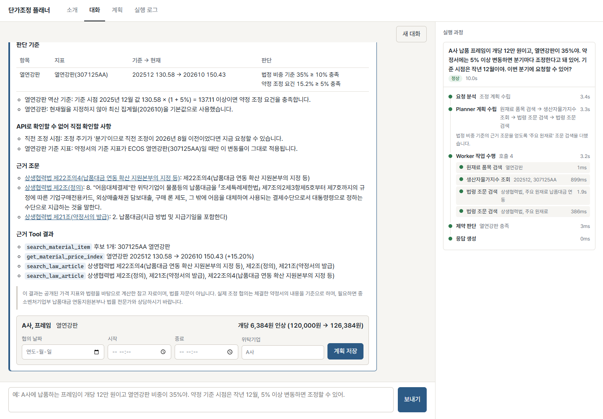
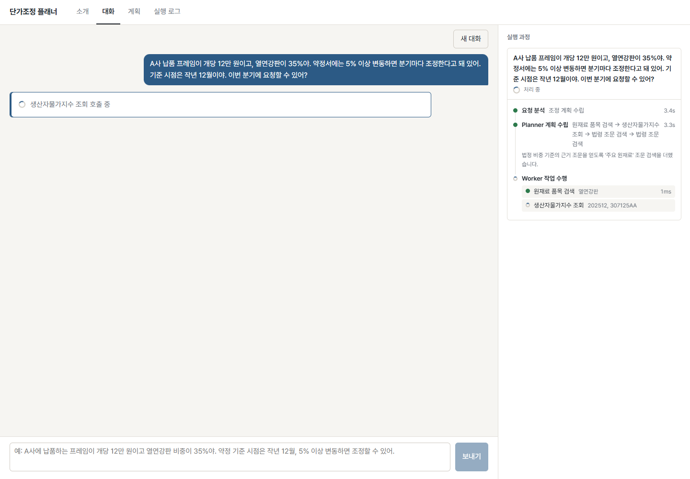
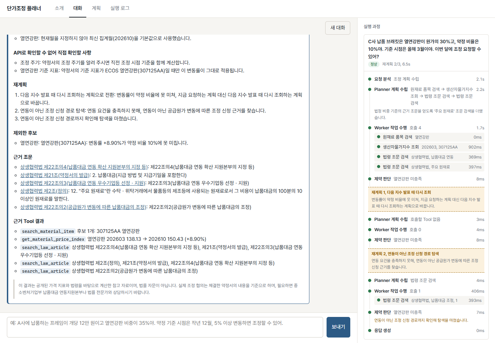
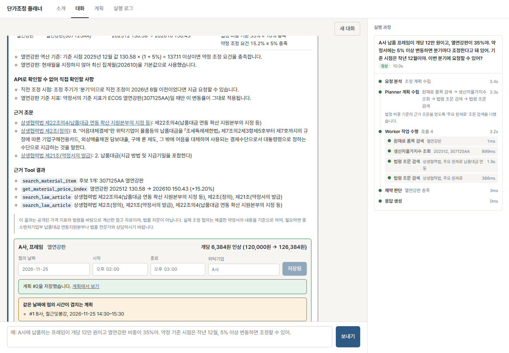
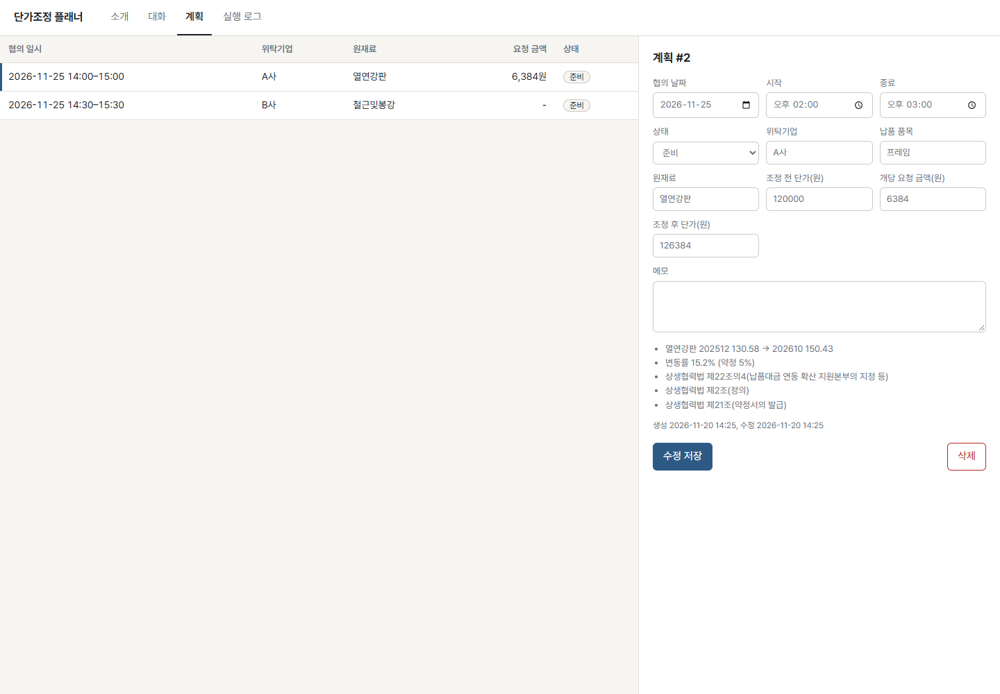
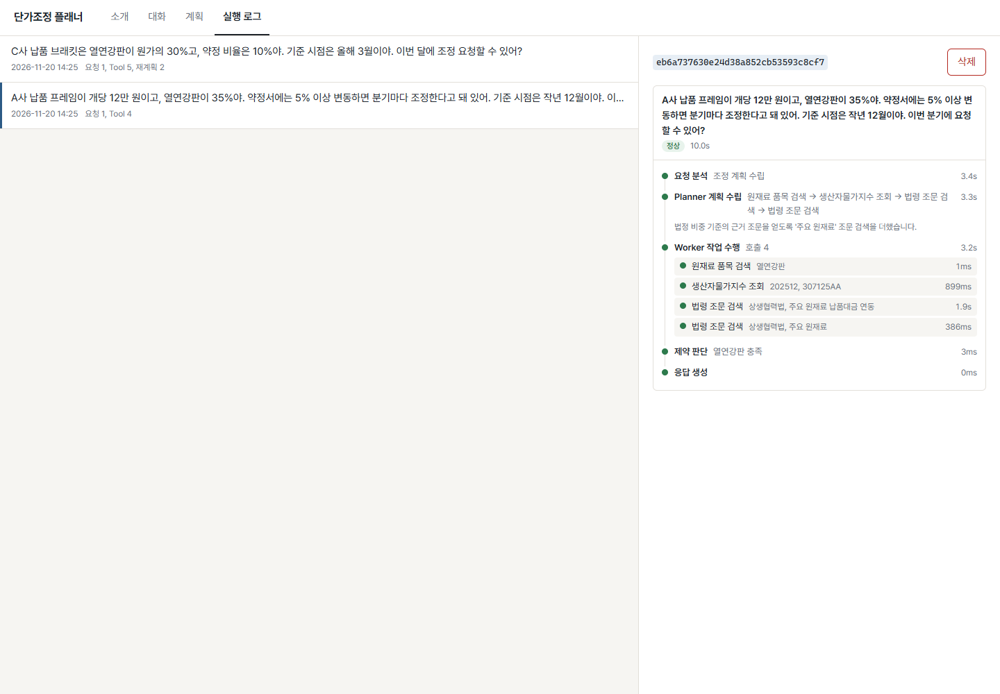
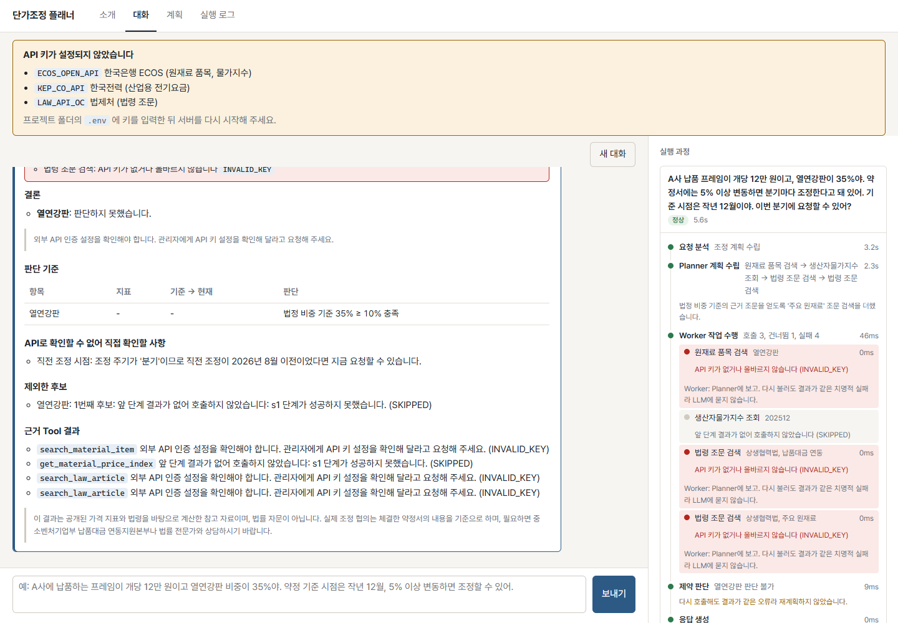
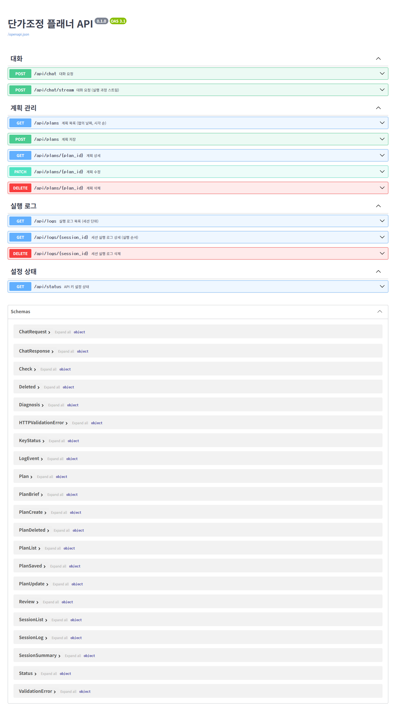

# 검증 결과

- 실행일: 2026-11-18 ~ 2026-11-19

## 1. 확인 항목별 결과

| 구분 | 요구사항 | 문서 | 실행 | 결과 |
|---|---|---|---|---|
| 2.7 기획 검증 |  | [requirements.md](../requirements.md) 3절, [verification_tools.md](verification_tools.md) 3절 | `check_tools.py`, `check_agent.py` | 통과 |
| 4.1 Tool | `F3001` ~ `F3004` | [verification_tools.md](verification_tools.md) | `check_tools.py` | 30/30 PASS |
| 4.2 메인 Agent | `F3005` ~ `F3011` | [verification_agent.md](verification_agent.md) | `check_agent.py` | 26/26 PASS |
| 4.3 로깅 Agent | `F3012` ~ `F3014` | [verification_logging.md](verification_logging.md) | `check_logging.py` | 14/14 PASS |
| 4.4 계획 관리 | `F3015` ~ `F3016` | [verification_plans.md](verification_plans.md) | `check_plans.py` | 11/11 PASS |
| 4.5 서비스, 화면 | `F3017` ~ `F3019` | [verification_service.md](verification_service.md) 2절 | `check_service.py` | PASS |
| 4.6 심화 | `F3020` | [verification_review.md](verification_review.md) | `check_review.py` | 16/16 PASS |
| 4.6 심화 | `F3021` | [verification_worker.md](verification_worker.md) | `check_worker.py` | 17/17 PASS |
| 4.7 대표 시나리오 |  | [verification_scenarios.md](verification_scenarios.md) | `check_service.py` | 5/5 PASS |
| 4.8 비기능 | `NF3001` ~ `NF3007` | [verification_service.md](verification_service.md) 3절 | `check_service.py` | 7/7 PASS |
| 단위 테스트 | 전체 |  | `python -m unittest discover -s backend/tests` | 104/104 OK |

`check_service.py`는 4.5, 4.7, 4.8을 합쳐 23/23 PASS 입니다. 모든 `check_*.py`는 `backend/`에 있으며 실제 LLM과 외부 API를 호출합니다.

## 2. 실행 결과 화면

`python backend/capture_screens.py`로 캡처했습니다.

| 구분 | 화면 |
|---|---|
| 4.2, 4.5 답변, 실행 단계, Tool 호출 이력 |  |
| 4.5 처리 중 상태 |  |
| 4.2, 4.5 재계획 지점 구분 |  |
| 4.4 겹치는 계획을 저장 결과와 함께 알림 |  |
| 4.4 계획 목록과 상세 (핵심 값, 생성 일시, 수정, 삭제) |  |
| 4.3 실행 로그 목록과 실행 순서 상세 |  |
| 4.5 Tool 실패, API 키 누락 안내 |  |
| 4.5 API 경로와 스키마 (FastAPI 문서) |  |

## 3. 실행 로그 샘플

| 샘플 | 위치 |
|---|---|
| 대표 요청 1건의 전체 실행 로그 | [verification_logging.md](verification_logging.md) 3절, [verification_agent.md](verification_agent.md) 3절 |
| 재계획이 발생한 사례 | [verification_agent.md](verification_agent.md) 6절, [verification_logging.md](verification_logging.md) 4절, [verification_scenarios.md](verification_scenarios.md) 2, 3절 |
| 이상 징후 판정과 진단 | [verification_review.md](verification_review.md) 4절 |
| Planner·Worker 메시지 | [verification_worker.md](verification_worker.md) 3절 |

## 4. 제출 전 점검 목록

| 점검 항목 | 확인 결과 |
|---|---|
| 필수 기능 `F3001` ~ `F3019`가 모두 동작한다 | ✅ 1절 4.1 ~ 4.5 모두 PASS |
| 선택한 심화 기능이 동작하고, 필수 기능의 결과와 비교되어 있다 | ✅ `F3020`, `F3021` PASS. 구조 변경 전후, Worker LLM 켬과 끔의 재계획 횟수, LLM 호출 수, 응답 시간 비교: [verification_worker.md](verification_worker.md) 4절 |
| 증명을 위한 스크린샷과 실행 로그 항목을 모두 첨부했다 | ✅ 2절 화면 8장, 3절 실행 로그 샘플 |
| 요구사항 정의서, Agent 설계 문서, Tool 정의서, API 명세서, 구현 소스코드, 실행 로그 샘플, README.md를 모두 포함했다 | ✅ [requirements.md](../requirements.md), [agent_design.md](../agent_design.md), [tool_spec.md](../tool_spec.md), [api_spec.md](../api_spec.md), `backend/`, `frontend/`, 3절, [README.md](../../README.md) |
