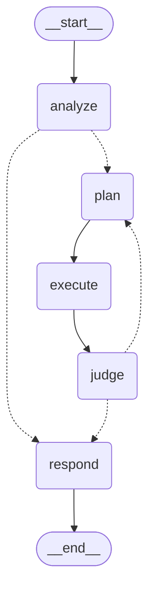

# 검증 결과: 메인 Agent 실행 흐름 `F3005` ~ `F3011`

- 실행일: 2026-11-18
- 확인 항목과 LLM의 Tool 선택 확인 결과를 기록합니다.
- 설계: [agent_design.md](../agent_design.md)

## 1. 실행 방법

```bash
# 실제 LLM(OpenAI)과 외부 API를 호출하는 확인: 26개 항목
python backend/check_agent.py
python backend/check_agent.py --graph    # 그래프 구조(Mermaid)만 출력

# LLM과 외부 API 없이 실행하는 단위 테스트: Agent 17개 + Tool 22개
python -m unittest discover -s backend/tests -v
```

| 실행 | 결과 |
|---|---|
| `backend/check_agent.py` | **26/26 PASS**, 3번 연달아 실행해 모두 통과 (회당 64~66초, 요청 10건, 모델 `gpt-6-luna`) |
| `unittest` | **39/39 OK** |

대표 요청 전체 상태는 `data/agent/representative.json`, 재계획 사례는 `replan.json`, `replan_limit.json`에 남깁니다 (형상관리 제외). 출력, 저장 파일, 코드에 `.env`의 키 4종 값이 없음을 문자열 대조로 확인했습니다. `NF3001` `NF3002`

## 2. 확인 항목

| # | 확인 항목 | 확인 방법, 실제 결과 | 결과 |
|---|---|---|---|
| 1 | 추출한 조건(기준, 선호, 제약)을 출력하고, 요청에 없던 조건이 채워지지 않았는지 | 3절 출력. `current_month`, `index_name`, `region`, `city`가 모두 `null` | PASS |
| 2 | 그래프가 분석 → 계획 → 실행 → 판단 → 응답 노드로 구성되는지 | `graph.get_graph()` 노드 = `analyze, plan, execute, judge, respond` (4절) | PASS |
| 2.7 | Tool 명세를 함께 넘겼을 때 LLM이 Tool 호출을 선택하는지 | `catalog()`를 받은 LLM 초안: `search_material_item → get_material_price_index → search_law_article("납품대금 연동")`, `plan.source = llm` (3절) | PASS |
| 3 | Tool이 필요한 요청과 필요 없는 요청의 계획이 다른지 | 대표 요청: `search_material_item → get_material_price_index → search_law_article × 2`. "안녕하세요", "이 서비스는 어떻게 쓰면 돼?": 의도 `chat`, 계획 없음, Tool 호출 0건. 조건이 모자란 요청: Tool 호출 전 3개 질문. 대상 여부 판정: LLM 초안부터 근거 조문만, 보정 없음 | PASS |
| 4 | 앞 Tool 결과가 다음 Tool 입력으로 전달되는지, Tool 하나를 실패시켜도 나머지가 진행되는지 | `args_from: s1.candidates[0].item_code` → `item_code: 307125AA`. `search_material_item`을 `UPSTREAM_ERROR`로 실패시킴 → `s2 SKIPPED`, `s3 search_law_article` 성공, 응답 생성, 재계획 0회 | PASS |
| 5 | 제약 판단 계산 값과 충족 여부가 응답의 판단 기준과 일치하는지 | 변동률 15.29% ≥ 5% 충족, 120,000 × 35% × 15.29% = **6,422원**. `recommendations`, `criteria`, `text` 값이 같음 | PASS |
| 6 | API로 확인할 수 없는 값을 지어내지 않고 역산 기준으로 제시하는지 | 요건 충족 지수 130.58 × 1.05 = 137.11. 직전 조정 시점은 "직전 조정이 2026년 8월 이전이었다면", 지표 일치는 "ECOS 열연강판(307125AA)일 때만", 다음 발표일은 날짜 대신 "2026년 10월 지수가 집계된 뒤" | PASS |
| 7 | 충족 후보가 없는 요청으로 재계획을 일으켜, 확보한 Tool 결과를 다시 호출하지 않는지 | 6.1절. 재계획 2회, `search_material_item`, `get_material_price_index` 각 1회만 호출 | PASS |
| 8 | 재계획이 상한에 도달하면 멈추고 사유와 함께 응답하는지 | 6.2절. 3회에서 "재계획 상한(3회)에 도달해 탐색을 멈췄습니다." + 조건 조정 되물음 | PASS |
| 9 | 후속 요청에서 바뀐 조건만 갱신되는지 | "같은 조건에서 원재료만 알루미늄으로 바꿔서 계산해 줘." → `changed = ["items"]`, 비중 35% 와 나머지 조건 유지 (7절) | PASS |
| 10 | 응답에 추천 항목, 보조 정보, 판단 기준, 근거 Tool 결과가 함께 있는지, 제외 후보에 사유가 있는지 | 추천 1, 조문 4, 근거 4. 판단 기준(법정 비중 10%)의 근거인 제2조 포함. E사 요청: "열연강판(307125AA): 변동률 +8.99%가 약정 비율 10%에 못 미칩니다." | PASS |
| 11 | 위험 도메인 면책 안내 | 결과, 대화 응답 `text` 끝에 면책 문구 | PASS |

대표 요청 처리 시간은 8.4 ~ 9.5초입니다. `NF3005` Tool 4건이 약 3.4초, 나머지는 LLM 2회(분석, 계획)입니다.

## 3. 대표 요청 1건 전체 실행 기록

**요청:** "A사 납품 프레임이 개당 12만 원이고, 열연강판이 35%야. 약정서에는 5% 이상 변동하면 분기마다 조정한다고 돼 있어. 기준 시점은 작년 12월이야. 이번 분기에 요청할 수 있어?"

**analyze**

```json
{"intent": "plan", "intent_reason": "납품대금 조정 요건을 제시하고 이번 분기에 요청할 수 있는지 물었습니다.",
 "conditions": {
   "기준": {"client": "A사", "product": "프레임", "unit_price_won": 120000,
            "items": [{"name": "열연강판", "kind": "material", "share_pct": 35.0}],
            "base_month": "202512", "current_month": null, "timing": "이번 분기"},
   "선호": {"index_name": null, "region": null, "city": null},
   "제약": {"threshold_pct": 5.0, "cycle": "분기"}},
 "missing": []}
```

**plan** (LLM 초안 → 검증, 보정)

```json
{"source": "llm",
 "draft": [{"tool": "search_material_item", "item": "열연강판", "keyword": "열연강판",
            "purpose": "약정 기준월과 비교할 열연강판 생산자물가지수 품목 코드를 확인한다."},
           {"tool": "get_material_price_index", "item": "열연강판", "keyword": null,
            "purpose": "기준월 202512 대비 최신 지수 변동률을 계산해 약정의 5% 기준 충족 여부를 판단한다."},
           {"tool": "search_law_article", "item": null, "keyword": "납품대금 연동",
            "purpose": "변동률에 따른 납품대금 조정 판단의 법적 근거 조문을 확인한다."}],
 "draft_reason": "계획 판단은 원재료의 기준월 대비 변동률과 약정 기준을 비교해야 하며, 조문 근거도 함께 제시해야 한다.",
 "corrections": ["법정 비중 기준의 근거 조문을 얻도록 '주요 원재료' 조문 검색을 더했습니다."]}
```

**execute**

| 단계 | Tool | 인자 | 입력 전달 | 결과 | 시간 |
|---|---|---|---|---|---|
| s1 | `search_material_item` | `keyword=열연강판` | — | 후보 1개: 307125AA 열연강판 | 2ms (품목 캐시) |
| s2 | `get_material_price_index` | `base_month=202512, include_trend=true` | `item_code ← s1.candidates[0].item_code` = 307125AA | 130.58 → 150.55 (+15.29%) | 1,517ms |
| s3 | `search_law_article` | `law_name=상생협력법, keyword=납품대금 연동` (LLM 선택) | — | 제22조의4, 제21조, 제22조의3 | 1,293ms |
| s4 | `search_law_article` | `law_name=상생협력법, keyword=주요 원재료` (보정) | — | 제2조, 제21조, 제22조의4 | 538ms |

**judge**

| 검사 | 값 | 기준 | 결과 |
|---|---|---|---|
| 법정 비중 기준 | 35% | ≥ 10% | 충족 |
| 약정 조정 요건 | 15.29% | ≥ 5% | 충족 |
| 요청 금액 | 120,000 × 35% × 15.29% = 6,422원 | | 126,422원 |
| 요건 충족 지수 (역산) | 130.58 × 1.05 = 137.11 | | |

재계획: 없음 (충족 항목 있음).

**respond** (`text`)

```markdown
## 결론
- **열연강판**: 조정 요청 요건을 충족합니다. 개당 6,422원 인상 요청 (120,000원 → 126,422원)

## 판단 기준
| 항목 | 지표 | 기준 → 현재 | 판단 |
|---|---|---|---|
| 열연강판 | 열연강판(307125AA) | 202512 130.58 → 202609 150.55 | 법정 비중 기준 35% ≥ 10% 충족<br>약정 조정 요건 15.29% ≥ 5% 충족 |
- 열연강판 역산 기준: 기준 시점 2025년 12월 값 130.58 × (1 + 5%) = 137.11 이상이면 약정 조정 요건을 충족합니다.
- 열연강판: 현재월을 지정하지 않아 최신 집계월(202609)을 기본값으로 사용했습니다.

## API로 확인할 수 없어 직접 확인할 사항
- 직전 조정 시점: 조정 주기가 '분기'이므로 직전 조정이 2026년 8월 이전이었다면 지금 요청할 수 있습니다.
- 열연강판 기준 지표: 약정서의 기준 지표가 ECOS 열연강판(307125AA)일 때만 이 변동률이 그대로 적용됩니다.

## 근거 조문
- [상생협력법 제22조의4(납품대금 연동 확산 지원본부의 지정 등)](…/제22조의4): 제22조의4(납품대금 연동 확산 지원본부의 지정 등)
- [상생협력법 제21조(약정서의 발급)](…/제21조): 2. 납품대금(지급 방법 및 지급기일을 포함한다)
- [상생협력법 제22조의3(납품대금 연동 우수기업등 선정ㆍ지원)](…/제22조의3): 제22조의3(납품대금 연동 우수기업등 선정ㆍ지원)
- [상생협력법 제2조(정의)](https://www.law.go.kr/법령/대ㆍ중소기업상생협력촉진에관한법률/제2조): 12. "주요 원재료"란 … 그 비용이 납품대금의 100분의 10 이상인 원재료를 말한다.

## 근거 Tool 결과
- `search_material_item` 후보 1개: 307125AA 열연강판
- `get_material_price_index` 열연강판 202512 130.58 → 202609 150.55 (+15.29%)
- `search_law_article` 상생협력법 제22조의4(…), 제21조(약정서의 발급), 제22조의3(…)
- `search_law_article` 상생협력법 제2조(정의), 제21조(약정서의 발급), 제22조의4(…)

> 이 결과는 공개된 가격 지표와 법령을 바탕으로 계산한 참고 자료이며, 법률 자문이 아닙니다. …
```

## 4. 그래프 구조

`python backend/check_agent.py --graph` 출력:



## 5. 그 밖의 요청 유형

| 요청 | 의도 | 계획, 호출 | 응답 |
|---|---|---|---|
| "안녕하세요" | chat | 없음 | LLM 인사 + 면책 안내 |
| "철판값이 많이 올랐는데, D사한테 단가 올려 달라고 해도 돼?" | plan | 없음 (되물음) | 비중, 기준 시점, 약정 비율 3개 질문 |
| "알루미늄이 원가의 8%인데 연동 대상이야?" | eligibility | `search_law_article`(주요 원재료) → 재계획 `search_law_article`(납품대금 조정) | 8% < 10% 대상 아님, 대안 경로 제22조의2 |
| "D사 … 철판이 40% … 약정 비율 10% …" | plan | 1회 재계획(`next_candidate`) | 열연강판 8.99% 미달 → 중후판 11.44% 충족, 단가의 4.58% |
| "전기료가 납품대금의 12% … 3% 이상 … 작년 12월" | plan | `get_industrial_power_price` → 재계획 `alt_path` | -11.05% 미충족, 인하 조정 가능 상황 안내, 계절 요금 차이 안내 |

## 6. 재계획 사례

### 6.1 재계획 후 대안 제시 (결과 재사용)

**요청:** "C사 납품 브래킷은 열연강판이 원가의 30%고, 약정 비율은 10%야. 기준 시점은 올해 3월이야. 이번 달에 조정 요청할 수 있어?"

| round | 방법 | 이유 | 새 단계 | 재사용 |
|---|---|---|---|---|
| 0 | initial | LLM 계획 | s1 후보 조회, s2 상세 조회(307125AA), s3 조문(납품대금 연동), s4 조문(주요 원재료, 보정) | — |
| 1 | recheck | 8.99% < 10%. 다음 지수 발표 때 다시 조회하는 계획으로 전환 | 없음 (s2의 `trend` 사용) | s1 ~ s4 |
| 2 | alt_path | 연동 요건 미충족. 조정 신청 근거 탐색 | s5 조문(납품대금 조정) | s1 ~ s4 |

- 실제 호출: `search_material_item` 1회, `get_material_price_index` 1회, `search_law_article` 3회.
- 응답: 요건 충족 지수 138.13 × 1.10 = 151.94, "최근 6개월 평균 상승폭(월 1.61)이 이어지면 약 1개월 뒤(2026년 10월분)에 요건 지수에 닿을 것으로 추정 (추정)", 대안 경로 상생협력법 제22조의2.
- 멈춘 사유: "연동이 아닌 조정 신청 경로까지 확인해 탐색을 마쳤습니다."

### 6.2 재계획 상한 도달

**요청:** "D사 납품 커버는 철판이 40%야. 약정 비율 12%, 기준 시점 올해 3월, 분기 조정이야. 요청 가능해?"

| round | 방법 | 새 단계 | 결과 |
|---|---|---|---|
| 0 | initial | s1 후보 조회(철판 → 열연강판, 중후판), s2 열연강판, s3, s4 조문 (LLM 계획, 보정 없음) | 8.99% < 12% |
| 1 | next_candidate | s5 `get_material_price_index(307124AA)` ← `s1.candidates[1].item_code` | 중후판 11.44% < 12% |
| 2 | recheck | 없음 | 151.59 도달 약 1개월 뒤 (추정) |
| 3 | alt_path | s6 조문(납품대금 조정) | 제22조의2 |

- 3회째 판단에서도 충족 항목이 없어 "재계획 상한(3회)에 도달해 탐색을 멈췄습니다." 와 함께 조건 조정을 되묻습니다.
- 제외한 후보: 열연강판(307125AA) +8.99%, 중후판(두께3mm이상)(307124AA) +11.44%, 각각 약정 비율 12% 미달.
- `MAX_REPLAN=2`로 바꾸면 2회에서 멈추는 것을 단위 시험 `test_replan_limit`으로 확인했습니다.

## 7. 후속 요청 (대화 맥락)

| | 조건 |
|---|---|
| 직전 | 위탁기업=A사, 품목=프레임, 단가=120000, **열연강판(35%)**, 기준 시점=202512, 요청 시점=이번 분기, 약정 비율=5, 주기=분기 |
| "같은 조건에서 원재료만 알루미늄으로 바꿔서 계산해 줘." | 위탁기업=A사, 품목=프레임, 단가=120000, **알루미늄(35%)**, 기준 시점=202512, 요청 시점=이번 분기, 약정 비율=5, 주기=분기 |

- `changed = ["items"]`. 결과: 알루미늄1차제품 +17.42%, 요청 7,316원.
- 대화 맥락에 남은 값: `conditions`, `history` 2건("조정 계획 수립: 열연강판 충족(+15.29%), 요청 6,422원" 등). `step_results`, `cache`는 비어 있습니다.

## 8. 기대한 동작과 실제 동작의 차이, 반영한 설계 변경

| 확인 중 발견 | 변경 |
|---|---|
| 제안서 시나리오 2(형강 20%, 8%, 2026년 3월)는 실제 변동률이 12.62% 로 요건을 충족해 재계획이 일어나지 않음 | 재계획 사례를 열연강판 30%, 10% 로 바꿈 (8.99% 미달) |
| 재조회 계획에서 추세를 얻으려고 상세 조회를 다시 부르면 "이미 조회한 상세정보는 다시 부르지 않는다"에 어긋남 | 첫 계획에서 `include_trend=true`로 한 번만 받고, 재계획은 받은 추세로 계산 |
| 지수 발표일을 "11월 중순"으로 적으면 API로 확인하지 않은 날짜를 지어낸 것이 됨 | "2026년 10월 지수가 집계된 뒤"로 바꿈 |
| 모든 후보가 미달일 때 첫 후보를 대표로 보여 주면 가장 가까운 후보가 가려짐 | 변동률이 가장 큰 후보로 역산 기준, 추정을 계산 |
| `INVALID_KEY` 실패의 Tool 메시지가 제외 사유에 그대로 실림 (단위 시험에서 발견) | 키, 외부 API 오류는 일반 문구로 바꿈 `NF3002` |
| "열연강판 지수가 올해 얼마나 올랐어?" 에서 기준 시점을 뽑지 못해 되물음 | 분석 규칙에 "올해 → 작년 12월 대비" 환산을 더함 |
| 첫 구현은 계획을 규칙으로만 만들어, Tool 명세(description)를 Agent가 읽지 않음 | LLM이 `catalog()`를 보고 계획 초안을 고르고, 코드가 검증, 보정하도록 바꿈 |
| `gpt-6-luna`는 chat/completions에서 `reasoning_effort`를 주지 않으면 함수 호출이 400 오류 | 추론 모델이면 `reasoning_effort="none"`으로 호출 (`LLM_REASONING_EFFORT`로 변경 가능) |
| `bind_tools`로 고르게 하면 앞 Tool 결과를 기다려 첫 Tool 하나만 고름 | Tool 명세를 넘기고 단계 목록을 구조화 출력(`PlanDraft`)으로 받음 |
| LLM이 근거 조문 검색어로 "납품대금 연동"만 골라, 판단에 쓴 법정 비중 기준(제2조 12)의 근거가 응답에서 빠짐 | 판단 기준의 근거 조문 검색(`주요 원재료`, `에너지경비`)은 검증 단계에서 반드시 더함 |
