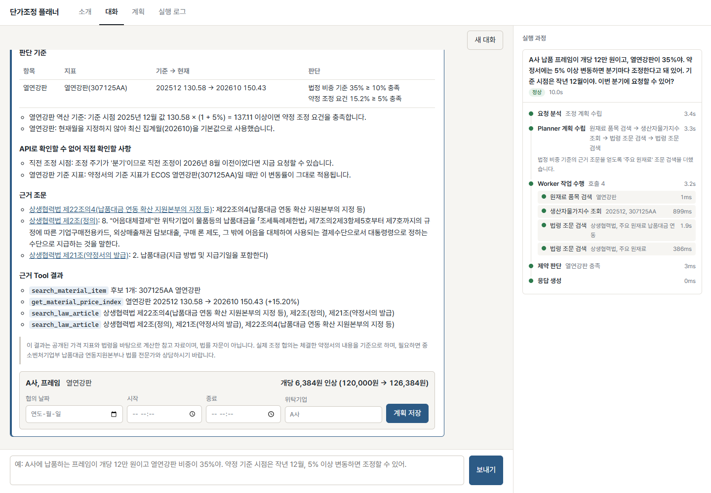
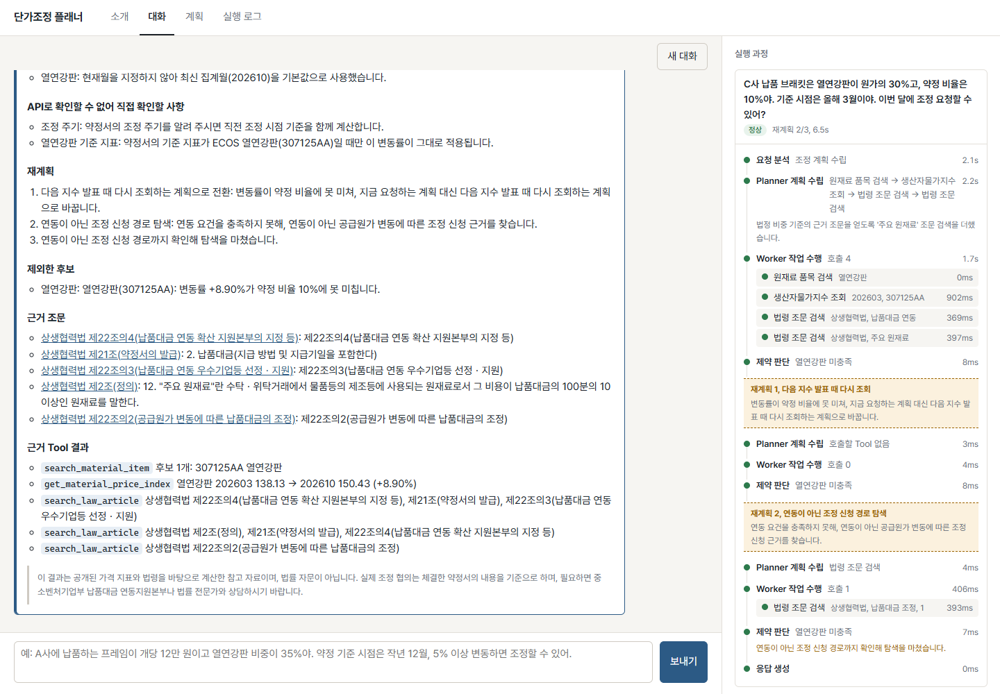

# 검증 결과: 대표 시나리오

- 실행일: 2026-11-19
- `python backend/check_service.py` (시나리오 5건 **5/5 PASS**). 요청별 응답과 실행 로그 전체는 `data/scenarios/1.json` ~ `5.json`에 저장합니다 (형상관리 제외).

| # | 경우 | 요청 | 결과 |
|---|---|---|---|
| 1 | 제약을 한 번에 충족 | A사 프레임, 열연강판 35%, 약정 5%, 기준 작년 12월 | PASS |
| 2 | 재계획이 필요 | C사 브래킷, 열연강판 30%, 약정 10%, 기준 올해 3월 | PASS |
| 3 | 상한에 도달 | D사 커버, 철판 40%, 약정 12%, 기준 올해 3월 | PASS |
| 4 | Tool 하나가 실패 | 1번 요청 + `search_law_article`을 `UPSTREAM_ERROR`로 실패시킴 | PASS |
| 5 | Tool이 필요 없음 | "이 서비스는 어떻게 쓰면 돼?" | PASS |

실행 로그의 `[n]`은 재계획 라운드입니다.

## 1. 제약을 한 번에 충족

**요청:** "A사 납품 프레임이 개당 12만 원이고, 열연강판이 35%야. 약정서에는 5% 이상 변동하면 분기마다 조정한다고 돼 있어. 기준 시점은 작년 12월이야. 이번 분기에 요청할 수 있어?"

| | 내용 |
|---|---|
| 실행 결과 | `result`. 열연강판 202512 130.58 → 202609 150.55 (+15.29%) ≥ 5%, 비중 35% ≥ 10% 충족. 개당 6,422원 인상 요청 (120,000원 → 126,422원). 요건 충족 지수 137.11 역산, 법정 비중 기준의 근거 조문(제2조) 포함, 면책 안내 |
| 실행 로그 | `analyze → plan → execute → judge → respond`, 재계획 0회, 8.4초 |
| Tool 호출 | `[0] search_material_item ok` → `[0] get_material_price_index ok` → `[0] search_law_article ok` × 2 |
| 기대한 동작 | 재계획 없이 요청 금액과 근거 조문 제시 |
| 차이 | 없음 |

대표 요청 1건의 전체 실행 로그(이벤트 단위)는 [verification_logging.md](verification_logging.md) 3절에, 단계별 상태는 [verification_agent.md](verification_agent.md) 3절에 있습니다.

## 2. 재계획이 필요

**요청:** "C사 납품 브래킷은 열연강판이 원가의 30%고, 약정 비율은 10%야. 기준 시점은 올해 3월이야. 이번 달에 조정 요청할 수 있어?"

| | 내용 |
|---|---|
| 실행 결과 | `result`. 열연강판 202603 138.13 → 202609 150.55 (+8.99%) < 10% 미충족. 요건 충족 지수 151.94, "최근 6개월 평균 상승폭(월 1.61)이 이어지면 약 1개월 뒤(2026년 10월분)에 닿을 것으로 추정", 대안 경로 상생협력법 제22조의2. 제외 사유 "변동률 +8.99%가 약정 비율 10%에 못 미칩니다." |
| 실행 로그 | `analyze → plan → execute → judge → ⟲재계획(recheck) → plan → execute → judge → ⟲재계획(alt_path) → plan → execute → judge → respond`, 재계획 2회, 7.5초 |
| Tool 호출 | `[0] search_material_item ok` → `[0] get_material_price_index ok` → `[0] search_law_article ok` × 2 → `[2] search_law_article ok` (납품대금 조정) |
| 기대한 동작 | 미달 → 재조회 계획, 대안 경로로 재계획. 확보한 지수는 다시 부르지 않음 |
| 차이 | 없음. `get_material_price_index` 1회만 호출, `recheck`는 첫 조회에서 받은 추세를 재사용 |

멈춘 사유: "연동이 아닌 조정 신청 경로까지 확인해 탐색을 마쳤습니다."

## 3. 상한에 도달

**요청:** "D사 납품 커버는 철판이 40%야. 약정 비율 12%, 기준 시점 올해 3월, 분기 조정이야. 요청 가능해?"

| | 내용 |
|---|---|
| 실행 결과 | `result`. 열연강판 +8.99%, 중후판 +11.44% 모두 12% 미달로 제외. 요건 충족 지수 151.59, 약 1개월 뒤 도달 추정, 대안 경로 제22조의2, 조건 조정을 되물음 |
| 실행 로그 | `analyze → plan → execute → judge → ⟲재계획(next_candidate) → … → ⟲재계획(recheck) → … → ⟲재계획(alt_path) → plan → execute → judge → respond`, 재계획 3회, 8.2초 |
| Tool 호출 | `[0] search_material_item ok` → `[0] get_material_price_index ok` (열연강판) → `[0] search_law_article ok` × 2 → `[1] get_material_price_index ok` (중후판, 후보 조회 결과의 2번째 코드) → `[3] search_law_article ok` |
| 기대한 동작 | 재계획 3회에서 멈추고 사유와 함께 응답 |
| 차이 | 없음. 멈춘 사유 "재계획 상한(3회)에 도달해 탐색을 멈췄습니다." |

## 4. Tool 하나가 실패

**요청:** 1번과 같음. 확인 스크립트가 `search_law_article`만 `UPSTREAM_ERROR`를 돌려주도록 바꿨습니다.

| | 내용 |
|---|---|
| 실행 결과 | `result`. 지수 계산과 요청 금액(6,422원)은 1번과 같음. 결론 아래 "외부 API가 응답하지 않습니다. 잠시 후 다시 시도해 주세요.", 근거 Tool 결과에 실패 2건 (`UPSTREAM_ERROR`) |
| 실행 로그 | `analyze → plan → execute → judge → respond`, 재계획 0회, 6.0초 |
| Tool 호출 | `[0] search_material_item ok` → `[0] get_material_price_index ok` → `[0] search_law_article UPSTREAM_ERROR` × 2 |
| 기대한 동작 | 실패한 Tool만 사유를 남기고 나머지는 진행. 다시 불러도 같은 실패이므로 재계획하지 않음 |
| 차이 | 없음 |

API 키가 없을 때(`INVALID_KEY`)의 화면은 [verification_service.md](verification_service.md) 2절에 있습니다. 이 경우에서 발견한 차이와 수정 내용도 같은 문서 4절에 기록했습니다.

## 5. Tool이 필요 없음

**요청:** "이 서비스는 어떻게 쓰면 돼?"

| | 내용 |
|---|---|
| 실행 결과 | `chat`. "납품대금 조정 상담을 원하시면 납품단가, 원재료 종류와 원가 비중, 약정된 조정 기준·비율, 기준 시점을 알려 주세요. …" + 면책 안내 |
| 실행 로그 | `analyze → respond`, 계획과 Tool 호출 없음, 4.0초 |
| 기대한 동작 | 의도 `chat`, 계획 단계를 건너뛰고 사용법 안내 |
| 차이 | 없음 |
