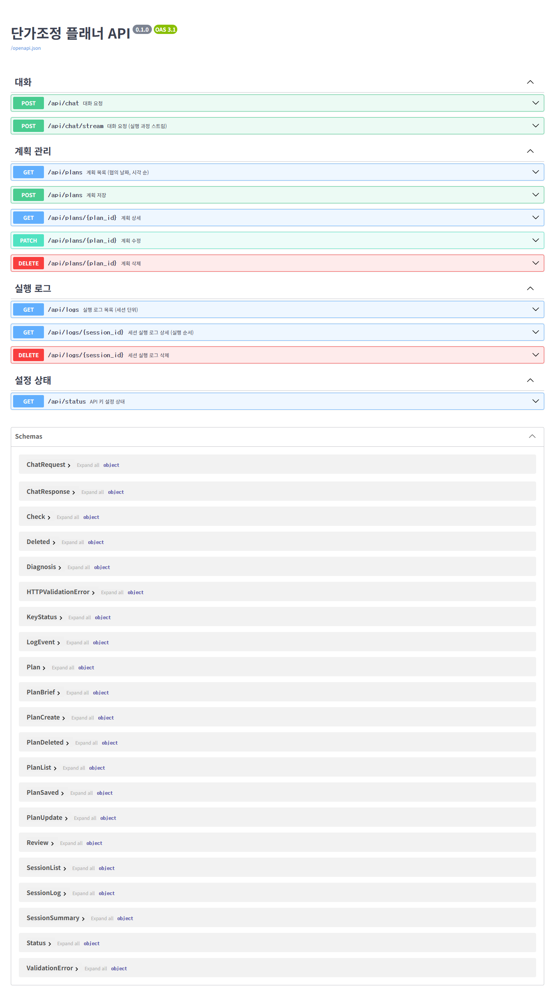
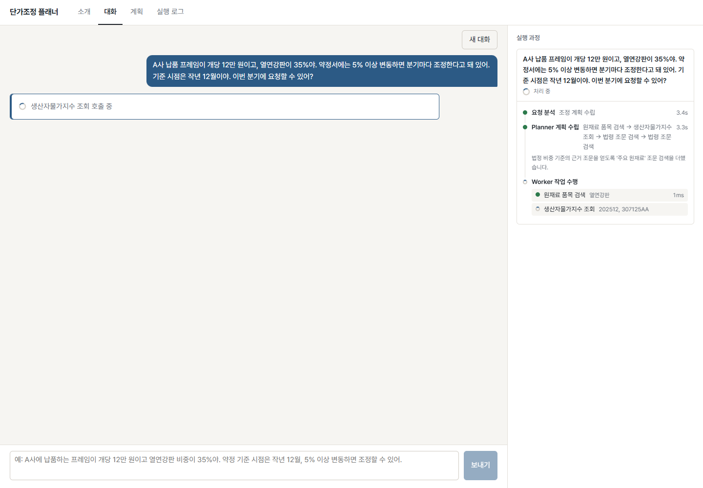
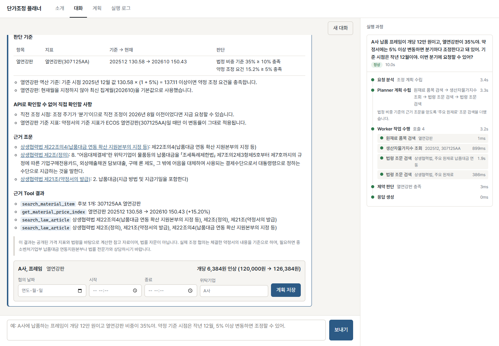
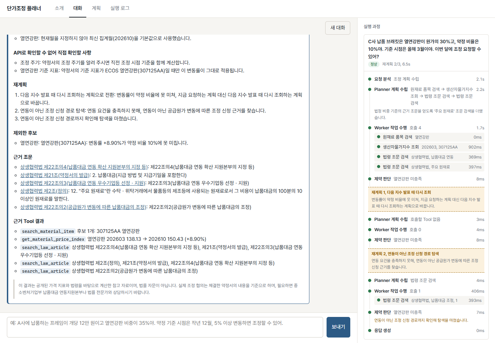
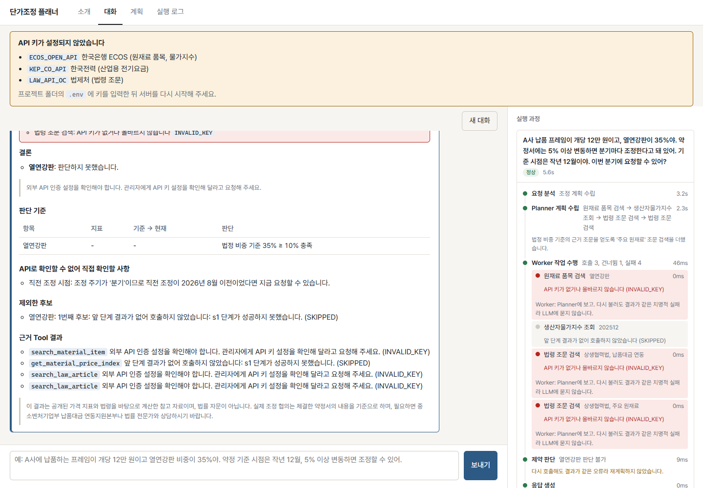

# 검증 결과: 서비스 구성과 화면, 비기능 요구사항 `F3017` ~ `F3019`, `NF3001` ~ `NF3007`

- 실행일: 2026-11-19
- 확인 항목을 기록합니다.
- API: [api_spec.md](../api_spec.md)

## 1. 실행 방법

```bash
# 실제 LLM(OpenAI)과 외부 API를 호출하는 확인: 23개 항목
python backend/check_service.py

# 화면 캡처 (설치된 Chrome을 headless로 조작, docs/images/ 에 저장)
python backend/capture_screens.py

# LLM과 외부 API 없이 실행하는 단위 테스트
python -m unittest discover -s backend/tests -v
```

| 실행 | 결과 |
|---|---|
| `backend/check_service.py` | **23/23 PASS** (요청 8건, 모델 `gpt-6-luna`) |
| `unittest` | **104/104 OK** |

요청은 모두 화면과 같은 경로(`POST /api/chat/stream`)로 보냈습니다.

## 2. 확인 항목

| # | 확인 항목 | 확인 방법, 실제 결과 | 결과 |
|---|---|---|---|
| 1 | 대화, 계획 관리, 실행 로그 API가 서로 다른 경로로 동작하고 요청, 응답이 정의한 형식과 일치하는지 | 경로 `/api/chat`, `/api/chat/stream` / `/api/plans`, `/api/plans/{plan_id}` / `/api/logs`, `/api/logs/{session_id}`. OpenAPI에 Pydantic 모델 8종. 실제 대화 응답 5건을 `ChatResponse.model_validate`로 검증, 스트림 형식 `application/x-ndjson`. 계획 저장 201, 응답 키 `plan`, `overlaps`, `duplicates` | PASS |
| 2 | 대화 화면과 계획 관리 화면이 모두 백엔드 API를 호출해 데이터를 표시하는지 | `chat.js` → `api.chatStream`, `plans.js` → `api.plans`, `api.updatePlan`, `api.deletePlan`, `logs.js` → `api.logs`, `api.log`, `api.deleteLog`. 화면은 `.html`, `.css`, `.js` 만으로 구성 | PASS |
| 3 | 답변과 함께 실행 단계와 Tool 호출 이력이 실행 순서대로 표시되고, 재계획 지점이 구분되는지 | 이벤트 `seq`가 1..n으로 이어지고 `run_start → analyze → plan → execute → judge → respond → run_end`. 재계획 요청은 `decision(replan)` 뒤에 다시 `plan`이 시작되고, 화면은 이 이벤트를 별도 항목(`li.replan`)으로 그림 | PASS |
| 4 | 처리 중 상태가 표시되는지 | `node_start`마다 "<단계> 중", `tool_request`마다 "<Tool> 호출 중", 실행 과정 패널에 "처리 중" | PASS |
| 5 | Tool 실패 상태로 실행했을 때 안내가 표시되는지 | 법령 조문 검색을 `UPSTREAM_ERROR`로 실패시킴 → 실패 이벤트 2건, 응답 `fatal: ["UPSTREAM_ERROR"]`, `evidence`에 실패 항목, 결론 아래 "외부 API가 응답하지 않습니다. 잠시 후 다시 시도해 주세요." | PASS |
| 6 | API 키 누락 상태로 실행했을 때 안내가 표시되는지 | ECOS, 한전, 법제처 키를 비움 → `/api/status` `ready: false`, 응답 `missing_keys` 3개, `fatal: ["INVALID_KEY"]`. 화면 상단에 빠진 키와 쓰이는 곳, `.env` 설정 안내 | PASS |

### 화면

| 화면 | 확인 항목 |
|---|---|
|  | 1: 대화, 계획 관리, 실행 로그, 설정 상태 API와 스키마 |
|  | 4: "생산자물가지수 조회 호출 중", 실행 과정 패널의 "처리 중" |
|  | 2, 3: 답변과 실행 단계, Tool 호출 이력, 소요 시간 |
|  | 3: "재계획 1, 다음 지수 발표 때 다시 조회", "재계획 2, 연동이 아닌 조정 신청 경로 탐색" 구분 |
|  | 5, 6: 상단 설정 안내, Tool 별 `INVALID_KEY` 실패와 "다시 호출해도 결과가 같은 오류라 재계획하지 않았습니다." |

## 3. 확인 항목

| 번호 | 확인 항목 | 확인 방법, 실제 결과 | 결과 |
|---|---|---|---|
| `NF3001` | 소스코드와 제출물에 API 키가 남아 있지 않은지 | `git ls-files` 75개 파일을 `.env`의 키 4종 값과 문자열 대조 → 걸린 파일 없음. `.env`는 `.gitignore`로 제외, `.env.example`만 형상관리 | PASS |
| `NF3002` | 화면에 API 키와 오류 상세가 노출되지 않는지 | 대화 응답 8건(정상, 재계획, 상한, Tool 실패, 대화, 키 누락, 예외)의 스트림 원문을 키 값과 대조 → 없음. Agent가 `RuntimeError("Traceback secret http://internal")`을 던지게 하면 응답은 "요청을 처리하는 중 문제가 생겼습니다. 잠시 후 다시 시도해 주세요." | PASS |
| `NF3003` | Tool 호출이 실패해도 서비스가 중단되지 않는지 | 조문 검색 실패 요청이 `result`로 끝나고 요청 금액까지 제시. 이어서 보낸 "안녕하세요" 도 `chat`으로 정상 응답 | PASS |
| `NF3004` | 재계획 상한이 적용되는지 | 상한 요청에서 재계획 3회 후 "재계획 상한(3회)에 도달해 탐색을 멈췄습니다." | PASS |
| `NF3005` | 대표 요청의 처리 시간이 사용에 지장이 없는지 | 한 번에 충족 8.4초, 재계획 7.5초, 상한 8.2초, Tool 실패 6.0초, Tool 불필요 4.0초 (기준 30초) | PASS |
| `NF3006` | 프론트엔드와 백엔드가 분리되고 Agent와 Tool 코드가 파일로 나뉘는지 | `frontend/`는 HTTP로만 백엔드를 호출. `backend/app/agent/` 12개 파일(graph, planner, worker, judge, responder, logging_agent 등), `backend/app/tools/` 6개 파일(ecos, kepco, law, registry, base) | PASS |
| `NF3007` | 외부 API의 출처와 이용 조건을 기록했는지 | [README.md](../../README.md) '사용한 외부 API의 출처 및 이용 조건'에 ECOS, 법제처, 한국전력의 출처, 이용 조건, 호출 한도 | PASS |

## 4. 기대한 동작과 실제 동작의 차이

| 발견 | 원인 | 수정 |
|---|---|---|
| API 키가 없어 하나도 판단하지 못했는데, 응답이 "다른 원재료나 약정 조건을 알려 주시면 다시 계산하겠습니다" 라고 조건 변경을 요청함 | 충족 항목이 없을 때의 안내를 판단 불가와 요건 미달에 똑같이 붙임 | [responder.py](../backend/app/agent/responder.py): 재시도해도 같은 실패(`INVALID_KEY`, `UPSTREAM_ERROR`)로 모든 항목이 판단 불가이면 조건 변경 안내를 생략하고 설정 안내만 표시. 단위 시험 `test_key_failure_does_not_ask_to_change_conditions` 추가 |
